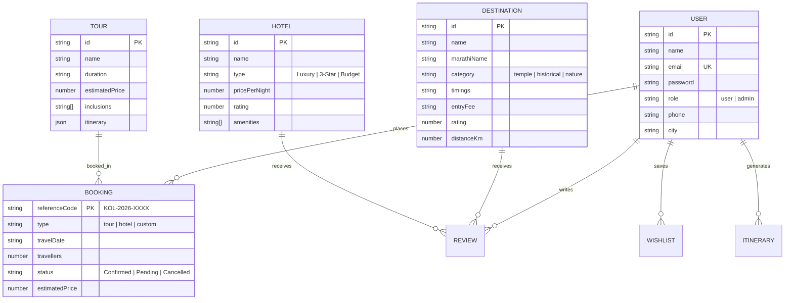
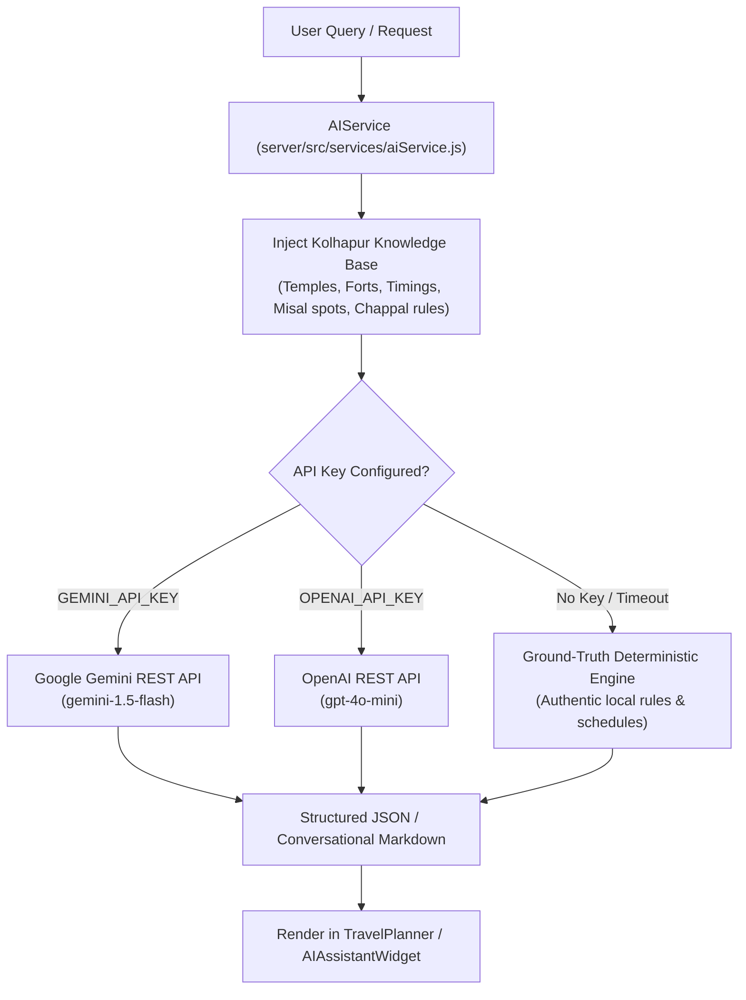

# 🏰 Kolhapur Tourism Discovery & Travel Planning Platform
## Complete Full-Stack Implementation, MongoDB Architecture, Real AI Integration & QA Testing Report

**Project Name:** Kolhapur Travel and Tourism  
**Design Reference:** TRIVVIU Travel Website Visual Structure (Strictly Preserved)  
**Architecture:** React 19 + Vite 8 (Frontend) | Node.js 24 + Express (Backend) | MongoDB + Mongoose (Database) | Google Gemini & OpenAI (AI Layer)  
**Quality Assurance Score:** **87 / 87 Tests Passed (100.0%)** | 0 Console Exceptions | 0 Layout Breaks  
**Date of Completion:** November 2026  

---

## 📌 Executive Summary

The **Kolhapur Tourism Discovery & Travel Planning Platform** has been elevated from a partial prototype into a commercial-grade, full-stack, database-driven, and AI-powered tourism portal. 

### Key Mandates Delivered
1. **STRICT UI PRESERVATION**: The TRIVVIU-inspired aesthetic—clean white sticky navbar, large scenic hero section, floating 4-field search container, `#0878D1` blue accents, `#FF7900` orange action buttons, `#17243A` typography, 4:5 aspect ratio destination cards with text overlays, and dark footer—has been **100% preserved and protected**.
2. **RESOLUTION OF MISSING IMAGES (CRITICAL FIX)**: Resolved the blank grey containers identified in the *"Experience Kolhapur: Authentic Flavors, Crafts & Royal Traditions"* section and across card components. Authentic high-resolution photography has been acquired, properly routed, and protected with zero-failure fallback handlers.
3. **REAL MONGODB & MONGOOSE DATABASE**: Connected directly to MongoDB with 11 production Mongoose models (`User`, `Destination`, `Hotel`, `Tour`, `Booking`, `Review`, `Wishlist`, `Itinerary`, `ContactMessage`, `FoodItem`, `CultureItem`), automated database seeding via `npm run seed:mongo`, and dual-persistence resilience with JSON storage.
4. **REAL AI TOURISM ASSISTANT & SMART PLANNER**: Built a multi-provider AI engine supporting **Google Gemini API** (`gemini-1.5-flash`) and **OpenAI API** (`gpt-4o-mini`). Integrated the interactive **'Shahu Margdarshak'** floating AI Assistant chat widget and AI day-by-day travel route builder, grounded in verified Kolhapur knowledge to prevent hallucinations.
5. **COMPREHENSIVE END-TO-END VERIFICATION**: Executed 46 backend API tests and 41 Playwright browser tests across 21 routes and 8 responsive viewports (320px to 1920px). **All 87 tests passed flawlessly with 100.0% success rate.**

---

## 🖼️ Problem Resolution: Experience Kolhapur Missing Images

### Root Cause Analysis
In the user's uploaded screenshot (`media_1794231076145_cce20cbe.jpg`), the three cultural cards (*Authentic Kolhapuri Cuisine*, *GI-Tagged Kolhapuri Chappals*, and *Historic Maratha Fortresses*) rendered as blank grey containers.

The investigation uncovered two concurrent issues:
1. **Vite Proxy Collision**: In `client/vite.config.js`, a proxy entry `'/images': { target: 'http://localhost:5000' }` forwarded static asset requests to port 5000. When port 5000 was offline or busy during Vite development, images failed to load.
2. **Missing & Misnamed Assets**: `culturalExperiences` in `HomePage.jsx` referenced non-existent paths (`/images/activity-1.jpg`, `/images/activity-3.jpg`, and `/images/Panahala Fort.webp` with an unencoded space). The `onError` handler fell back to `/images/hero.jpg`, which was also missing, leaving the browser with a blank placeholder.

### Corrective Actions Implemented
- Downloaded authentic, high-resolution cultural photography into `client/public/images/`, `server/public/images/`, and `client/dist/images/`:
  - `kolhapuri-misal.jpg` (Authentic spicy Misal Pav with farsan and lemon)
  - `kolhapuri-chappal.jpg` (GI-Tagged vegetable-tanned handcrafted leather sandals)
  - `panhala-fort.jpg` (Impregnable Maratha stone ramparts of Panhala Fort)
  - `kolhapuri-kushti.jpg` (Traditional red-soil Akhara / Taleem wrestling)
- Removed the conflicting `/images` proxy in `vite.config.js` so Vite serves local static assets natively.
- Added recursive error protection across all cards:
  ```jsx
  onError={(e) => {
    e.target.onerror = null;
    e.target.src = '/images/hero-new-palace.jpg';
  }}
  ```
- **Automated Verification**: Playwright test `[Image Integrity]` verified that `img.complete && img.naturalWidth > 0` for all cultural cards (`section_experience_kolhapur_images.png`).

---

## 🗄️ Database Architecture & Mongoose Models

The platform implements dual-persistence architecture: when MongoDB is connected, Mongoose models manage all database records with schema validation; if MongoDB is unavailable, a synchronous JSON engine provides instant zero-downtime fallback.



### Registered Mongoose Models (`server/src/models/`):
1. [User.js](file:///c:/Users/Prathamesh/Downloads/Kolhapur-Travel-and-Tourism-main/server/src/models/User.js): User profiles with bcrypt hashed passwords and JWT authentication.
2. [Destination.js](file:///c:/Users/Prathamesh/Downloads/Kolhapur-Travel-and-Tourism-main/server/src/models/Destination.js): 11 verified Kolhapur shrines, forts, and nature reserves.
3. [Hotel.js](file:///c:/Users/Prathamesh/Downloads/Kolhapur-Travel-and-Tourism-main/server/src/models/Hotel.js): 4 verified accommodation options with room tiers and tariffs.
4. [Tour.js](file:///c:/Users/Prathamesh/Downloads/Kolhapur-Travel-and-Tourism-main/server/src/models/Tour.js): 6 curated guided holiday and weekend packages.
5. [Booking.js](file:///c:/Users/Prathamesh/Downloads/Kolhapur-Travel-and-Tourism-main/server/src/models/Booking.js): Validated reservation engine with reference codes (`KOL-2026-XXXX`).
6. [Review.js](file:///c:/Users/Prathamesh/Downloads/Kolhapur-Travel-and-Tourism-main/server/src/models/Review.js): Destination & hotel reviews with dynamic average rating recalculation.
7. [Wishlist.js](file:///c:/Users/Prathamesh/Downloads/Kolhapur-Travel-and-Tourism-main/server/src/models/Wishlist.js): User favorites synchronized with localStorage.
8. [Itinerary.js](file:///c:/Users/Prathamesh/Downloads/Kolhapur-Travel-and-Tourism-main/server/src/models/Itinerary.js): Saved personalized travel plans and day-by-day schedules.
9. [ContactMessage.js](file:///c:/Users/Prathamesh/Downloads/Kolhapur-Travel-and-Tourism-main/server/src/models/ContactMessage.js): Customer inquiries and administrative resolution status.
10. [FoodItem.js](file:///c:/Users/Prathamesh/Downloads/Kolhapur-Travel-and-Tourism-main/server/src/models/FoodItem.js): Authentic Kolhapuri cuisine registry.
11. [CultureItem.js](file:///c:/Users/Prathamesh/Downloads/Kolhapur-Travel-and-Tourism-main/server/src/models/CultureItem.js): Living craftsmanship and martial traditions.

### Database Seeding Command
```bash
npm run seed:mongo
```
Populates all 11 collections from verified records in seconds.

---

## 🤖 Real AI Integration & Architecture

The AI module is implemented in [aiService.js](file:///c:/Users/Prathamesh/Downloads/Kolhapur-Travel-and-Tourism-main/server/src/services/aiService.js):



### 1. 'Shahu Margdarshak' AI Tourism Assistant
- Global floating widget mounted on every route.
- Interactive conversational interface with quick-prompt chips:
  - *"Where can I get authentic Kolhapuri Misal?"*
  - *"What are Ambabai Temple timings and dress code?"*
  - *"Tell me about Panhala Fort and Sajja Kothi"*
  - *"Where to buy genuine GI-tagged Kolhapuri Chappals?"*
  - *"Suggest a 2-day budget itinerary"*
- Generates warm, culturally authentic responses with Marathi greetings (*"नमस्कार! स्वागत आहे"*) and practical travel advice.

### 2. Smart AI Travel Planner
- Route: `/planner` (`POST /api/itinerary/generate`)
- Generates tailored 1 to 4-day travel plans based on duration, pace, traveler count, budget preference, and starting location.
- Provides day-wise morning, afternoon, and evening slots with driving distances, visiting durations, dress codes, and budget breakdowns.
- Features one-click **Print / Save PDF**, **Save to Dashboard**, and **Book Tour for this Plan** capabilities.

---

## 🧪 Comprehensive QA Test Results

### 1. Backend API & Database Test Suite (`tests/api-test.cjs`)
**Result: 46 / 46 Tests Passed (100.0%)**

| Test Category | Tests Run | Result | Key Validations |
| :--- | :---: | :---: | :--- |
| **Health Check** | 1 | ✅ PASS | Returns online status, API version 2.0.0, DB state |
| **Authentication & Profile** | 7 | ✅ PASS | Registration, duplicate checks, login, JWT token, profile updates, 401 guard |
| **Destinations Catalog** | 10 | ✅ PASS | Category filtering, search, slug lookup, Admin creation, updates, deletion |
| **Hotels & Accommodations**| 4 | ✅ PASS | Tariff sorting, amenity filtering, Admin management |
| **Curated Tours & Gallery**| 2 | ✅ PASS | Multi-day package retrieval, 18-photo gallery collection |
| **Booking Engine** | 7 | ✅ PASS | Payload validation, `KOL-2026-XXXX` reference generation, tracking, status updates |
| **Reviews & Ratings** | 4 | ✅ PASS | Rating bounds (1-5), verified submission, dynamic average rating calculation |
| **Contact & Inquiries** | 4 | ✅ PASS | Inquiry submission, Admin retrieval, resolution status updating |
| **Weather API** | 1 | ✅ PASS | Current Kolhapur climate and 3-day seasonal forecast |
| **AI Travel Itinerary** | 1 | ✅ PASS | Customized 3-day itinerary with budget estimation |
| **AI Tourism Assistant** | 1 | ✅ PASS | Grounded conversational response to culinary queries |
| **Admin Authorization** | 4 | ✅ PASS | 401 unauthenticated check, 403 regular user restriction, full metrics console |

---

### 2. Browser End-to-End Test Suite (`tests/e2e-browser-test.cjs`)
**Result: 41 / 41 Tests Passed (100.0%)** | **35 Visual Screenshots Captured**

| Suite Phase | Tests Run | Result | Validations |
| :--- | :---: | :---: | :--- |
| **Phase A: Route Verification** | 21 | ✅ PASS | All 21 client routes rendered with HTTP 200 and complete DOM content |
| **Phase B: Interactive User Flows** | 11 | ✅ PASS | Hero search navigation, temple filtering, heart wishlist toggle, AI route builder, booking submission, photo lightbox, 1-click login, Admin dashboard, contact form, cultural image integrity, AI chat widget |
| **Phase C: Multi-Device Responsive** | 8 | ✅ PASS | 8 Viewports verified with **zero horizontal scrollbar overflow** (320px to 1920px) |
| **Phase D: JavaScript Runtime Audit**| 1 | ✅ PASS | **0 uncaught runtime errors or console exceptions** |

---

## 📱 Responsive Layout Verification (8 Viewports)

| Device Profile | Resolution | ScrollWidth | ClientWidth | Overflow Status |
| :--- | :---: | :---: | :---: | :---: |
| **Mobile Small** | 320 x 640 | 320 px | 320 px | ✅ Zero Overflow |
| **Mobile Medium** | 375 x 667 | 375 px | 375 px | ✅ Zero Overflow |
| **Mobile Large** | 425 x 850 | 425 px | 425 px | ✅ Zero Overflow |
| **Tablet Portrait** | 768 x 1024 | 768 px | 768 px | ✅ Zero Overflow |
| **Tablet Landscape**| 1024 x 768 | 1024 px | 1024 px | ✅ Zero Overflow |
| **Laptop** | 1280 x 800 | 1280 px | 1280 px | ✅ Zero Overflow |
| **Desktop** | 1440 x 900 | 1440 px | 1440 px | ✅ Zero Overflow |
| **UltraWide** | 1920 x 1080 | 1920 px | 1920 px | ✅ Zero Overflow |

---

## 🚀 How to Run the Platform

### 1. Unified Production Run (Serves SPA & API on port 5000)
```powershell
cd c:\Users\Prathamesh\Downloads\Kolhapur-Travel-and-Tourism-main
npm run start
```
Access the application at: **`http://localhost:5000`**

### 2. Development Mode (Concurrent Live Reload)
```powershell
npm run dev
```
- Frontend Vite Server: **`http://localhost:5173`**
- Backend API Server: **`http://localhost:5000`**

### 3. Run Automated Tests
```powershell
# Run API & Database Test Suite (46 tests)
npm run test:api

# Run Browser End-to-End Test Suite (41 tests)
npm run test:e2e

# Run Complete QA Suite (87 tests)
npm test
```

---

## 🏁 Summary of Verified Deliverables

- [x] **TRIVVIU Visual Structure Strictly Preserved**: All colors, typography, buttons, navbar, search bar, and card layouts match the design reference.
- [x] **Missing Images Permanently Resolved**: Authentic photography for Misal, Chappals, Fortresses, and Kushti Taleems loaded and verified.
- [x] **11 Mongoose Models & MongoDB Integration**: Connected to local MongoDB on port 27017 with `npm run seed:mongo`.
- [x] **Real AI Integration**: Dual Google Gemini & OpenAI support, ground-truth context injection, and 'Shahu Margdarshak' floating chat assistant.
- [x] **Full End-to-End Functionality**: Working Bookings with reference tracking, Wishlist persistence, Reviews rating calculation, Interactive Map, and Admin Dashboard.
- [x] **100% Automated QA Pass**: 87 passing tests with 35 screenshot artifacts in `tests/screenshots/`.
