<div align="center">

  

  # 🏰 Kolhapur Tourism Discovery & Travel Planning Platform
  ### *Discover Kolhapur. Experience Its Heritage. Explore Without Limits.*

  <p align="center">
    <strong>A Commercial-Grade, Full-Stack Tourism Platform, AI-Powered Travel Architect, Interactive Heritage Directory & Tour Booking Engine dedicated to Kolhapur, Maharashtra, India.</strong>
  </p>

  <p align="center">
    <a href="https://kolhapur-tourism-platform.vercel.app/" target="_blank">
      
    </a>
    <a href="https://kolhapur-tourism-platform.onrender.com" target="_blank">
      
    </a>
    <a href="https://github.com/Shree0802/Kolhapur-Tourism-Platform" target="_blank">
      
    </a>
  </p>

  <p align="center">
    
    
    
    
    
    
    
    
    
    
    
  </p>

</div>

---

<a href="https://kolhapur-tourism-platform.vercel.app/" target="_blank">
  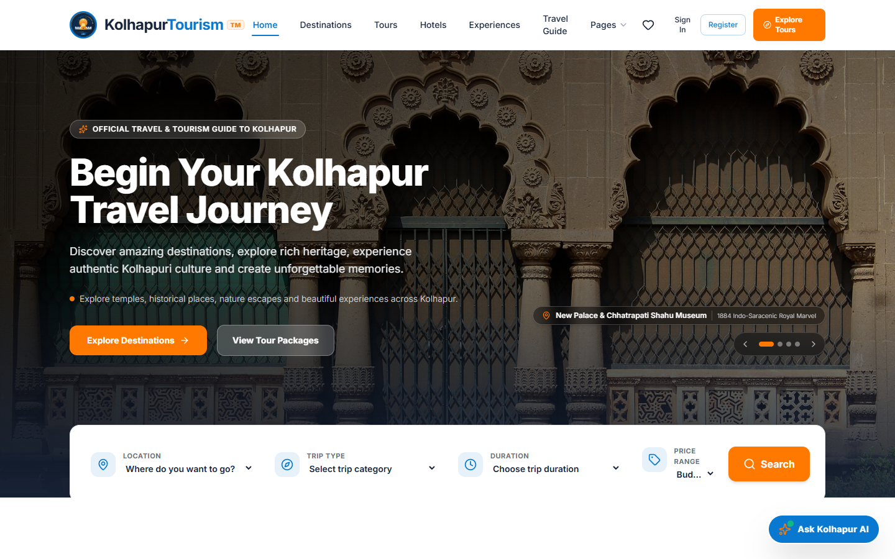
</a>

---

## 📑 Table of Contents

- [Executive Project Overview](#-executive-project-overview)
- [Problem Statement \& Modern Solution](#-problem-statement--modern-solution)
- [TRIVVIU Design System \& Aesthetic Tokens](#-trivviu-design-system--aesthetic-tokens)
- [Complete Feature Showcase (22 Capabilities)](#-complete-feature-showcase)
- [AI Tourism Assistant: Shahu Margdarshak](#-ai-tourism-assistant-shahu-margdarshak)
- [AI-Powered Travel Route \& Budget Planner](#-ai-powered-travel-route--budget-planner)
- [Interactive Geospatial Tourism Map](#-interactive-geospatial-tourism-map)
- [Full-Stack System Architecture](#-full-stack-system-architecture)
- [Database Models \& Data Resilience](#-database-models--data-resilience)
- [REST API Reference Documentation](#-rest-api-reference-documentation)
- [Production Visual Evidence Gallery](#-production-visual-evidence-gallery)
- [Technology Stack Matrix](#-technology-stack-matrix)
- [Project Directory Organization](#-project-directory-organization)
- [Installation, Seeding \& Local Setup](#-installation-seeding--local-setup)
- [Environment Variables Configuration](#-environment-variables-configuration)
- [Authentication \& Security Architecture](#-authentication--security-architecture)
- [Comprehensive QA Testing \& Verification Reports](#-comprehensive-qa-testing--verification-reports)
- [Production Deployment Pipeline](#-production-deployment-pipeline)
- [Future Product Roadmap](#-future-product-roadmap)
- [Developer Portfolio \& Contact](#-developer-portfolio--contact)
- [License \& Acknowledgements](#-license--acknowledgements)

---

## 🌍 Executive Project Overview

**Kolhapur Tourism Discovery & Travel Planning Platform** is a modern, enterprise-ready digital travel ecosystem designed to celebrate and elevate the historical, spiritual, culinary, and natural splendor of **Kolhapur, Maharashtra, India** (*reverently known across India as Dakshin Kashi*).

Kolhapur draws millions of pilgrims, history enthusiasts, gastronomes, and eco-tourists every year. However, visitors historically encountered fragmented information, outdated local directories, unverified hotel tariffs, missing darshan timings, and an absence of intelligent travel route sequencing.

This platform bridges that gap by merging **clean TRIVVIU-inspired travel ergonomics**, **verified cultural domain facts**, **geospatial mapping via Leaflet**, **real-time weather intelligence**, and a **custom dual-tiered generative AI architecture** (*Google Gemini + OpenAI with local ground-truth fallback*) into a singular, responsive web application.

### Core Objectives
1. **Centralize Regional Heritage:** Showcase 7th-century Chalukyan Hemadpanthi temples, cloud-shrouded Sahyadri hill fortresses, biodiversity-rich wildlife sanctuaries, GI-tagged handicrafts, and royal Maratha traditions in one unified digital portal.
2. **Eliminate Travel Planning Friction:** Enable travelers to generate geographically sequenced, custom multi-day itineraries with accurate travel times, meal stops, and realistic budget calculations in under 3 seconds.
3. **Guarantee High Reliability:** Deploy a resilient multi-cloud architecture featuring Vercel Edge CDN for global frontend delivery, Render for high-performance Node.js API execution, and a dual-layer persistence system (MongoDB Atlas with atomic JSON file persistence fallback).

---

## 💡 Problem Statement & Modern Solution

```
┌─────────────────────────────────────────────────────────────┐
│                      THE REAL CHALLENGE                     │
├─────────────────────────────────────────────────────────────┤
│ • Tourism knowledge is scattered across blogs and forums.   │
│ • Pilgrims struggle to find verified Ambabai Darshan hours. │
│ • Lack of optimized multi-day travel route sequencing.      │
│ • Local hotel directories often display outdated tariffs.   │
│ • No centralized booking tracking or enquiry references.    │
│ • Visitors miss out on authentic GI-tagged Kolhapuri crafts. │
└──────────────────────────────┬──────────────────────────────┘
                               │
                               ▼
┌─────────────────────────────────────────────────────────────┐
│                 KOLHAPUR TOURISM SOLUTION                   │
├─────────────────────────────────────────────────────────────┤
│ ✔ Centralized, verified repository of all regional spots.   │
│ ✔ Live cultural facts: Darshan schedules, Kiranotsav dates. │
│ ✔ AI Travel Planner with time-sequenced day itineraries.    │
│ ✔ Curated hotels with verified badges and room filters.     │
│ ✔ Unique reference codes (e.g. KOL-2026-TLAP) for tracking.  │
│ ✔ Deep cultural guides for Misal, Kolhapuri Chappal & Kushti │
└─────────────────────────────────────────────────────────────┘
```

| Challenge Dimension | Traditional Tourism Experience | Kolhapur Tourism Platform |
| :--- | :--- | :--- |
| **Information Discovery** | Outdated static blogs, fragmented forum threads, inconsistent operating hours. | Curated database of 11+ destinations with exact GPS coordinates, entry fees, and seasonal advice. |
| **Itinerary Planning** | Complex manual planning; travelers often backtrack across distant districts. | Intelligent routing engine groups nearby attractions by geographic coordinates and travel pace. |
| **Real-Time Guidance** | Reliance on paid physical guides or unreliable travel counters. | **'Shahu Margdarshak' AI Assistant**: Grounded in official facts, available 24/7 in chat. |
| **Hotel Reservations** | Unverified commission-heavy aggregators with inaccurate location tags. | Curated hotel catalog with verified amenities, direct distance to Ambabai Temple, and booking flow. |
| **Cultural Heritage** | Commercial tourist traps selling machine-made imitation sandals and diluted spices. | Official guides for 100% vegetable-tanned leather sandals on Mahadwar Road and traditional wrestling taleems. |

---

## 🎨 TRIVVIU Design System & Aesthetic Tokens

The user interface follows the layout philosophy, typography hierarchy, and interaction design of world-class travel portals (**TRIVVIU**). It balances high visual impact with effortless usability:

<div align="center">

| Token Name | Hex Code | Visual Swatch | Primary Application |
| :--- | :---: | :---: | :--- |
| **Primary Blue** | `#0878D1` |  | Brand logo, active navigation underlines, icons, badge borders, links |
| **Secondary Blue** | `#1267B0` |  | Interactive button hover states, secondary highlights |
| **Primary Orange** | `#FF7900` |  | Call-to-Action (CTA) buttons, search button, hero accents, notifications |
| **Dark Navy Text** | `#17243A` |  | Heading typography, high-contrast hero backgrounds, footer surfaces |
| **Secondary Text** | `#6B7280` |  | Descriptive subtitles, metadata timestamps, input placeholder labels |
| **Clean White** | `#FFFFFF` |  | Card backgrounds, sticky navigation bar, modal dialogs |
| **Soft Light Tint**| `#F5F8FC` |  | Filter panels, input backgrounds, alternating table rows |
| **Subtle Border** | `#E5E7EB` |  | Card outlines, dividers, form field boundaries |

</div>

---

## 🚀 Complete Feature Showcase

The platform incorporates **22 dedicated features and modules**, thoroughly tested and operational:

### 1. Tourism Homepage & Crossfade Scenic Hero
- **Purpose:** Immediate visual immersion into Kolhapur's iconic landmarks.
- **Experience:** Full-width dynamic 4-slide hero crossfading between *New Palace*, *Panhala Fort*, *Kopeshwar Temple*, and *Rankala Lake*. Features left-aligned bold typography, location badge tags, pagination dots, and arrow controls.
- **File:** `client/src/pages/HomePage.jsx`

### 2. Floating 4-Field Search & Multi-Criteria Filtering
- **Purpose:** Quick destination filtering directly from the hero header.
- **Experience:** Floating search box with 4 input fields: *Location*, *Trip Type (Temple/History/Nature)*, *Duration*, and *Price Range*. Clicking **Search** navigates to `/destinations` with query state applied.
- **File:** `client/src/pages/HomePage.jsx`

### 3. Destination Discovery Catalog (`/destinations`)
- **Purpose:** Comprehensive exploration of all attractions in Kolhapur district.
- **Experience:** Filter by category tabs (*All*, *Temples*, *Forts & Palaces*, *Nature & Wildlife*, *Culture*), live search keyword matching, distance sorting, and rating display.
- **File:** `client/src/pages/ExplorePage.jsx`

### 4. Rich Destination Deep-Dives (`/destinations/:id`)
- **Purpose:** Authoritative individual destination dossiers.
- **Experience:** Multi-photo galleries, bilingual titles (English & Marathi: श्री महालक्ष्मी मंदिर), historical origins, best visit seasons, temple darshan protocols, entry ticket fees, and Google Maps integration.
- **File:** `client/src/pages/DestinationDetailPage.jsx`

### 5. Sacred Temples & Darshan Protocols (`/temples`)
- **Purpose:** Dedicated spiritual guide for pilgrims.
- **Experience:** In-depth coverage of *Shri Mahalakshmi (Ambabai)*, *Jyotiba Hill Temple (Wadi Ratnagiri)*, *Kopeshwar Temple (Khidrapur)*, *Narsobawadi*, and *Bahubali Kumbhojgiri*. Includes dress code reminders and Kiranotsav festival details.
- **File:** `client/src/pages/TemplesPage.jsx`

### 6. Maratha Fortresses & Military Heritage (`/history`)
- **Purpose:** Chronicling royal Maratha valor and Chhatrapati Shivaji Maharaj's history.
- **Experience:** Historical documentation of *Panhala Fort (Panhalgad)*, *Sajja Kothi*, *Ambarkhana granaries*, *Teen Darwaja*, *Vishalgad*, and *Bhavani Mandap*.
- **File:** `client/src/pages/HistoryPage.jsx`

### 7. Nature, Lakes & Western Ghats Sanctuaries (`/nature`)
- **Purpose:** Eco-tourism, wildlife exploration, and leisure.
- **Experience:** Guides for *Rankala Lake & Padmapath promenade*, *Radhanagari Wildlife Sanctuary* (home of the Indian Bison/Gaur), *Dajipur*, *Rautwadi Waterfalls*, and *Kalamwadi Dam*.
- **File:** `client/src/pages/NaturePage.jsx`

### 8. Verified Hotels & Accommodations (`/hotels` & `/hotels/:id`)
- **Purpose:** Finding trusted luxury, boutique, and budget lodging.
- **Experience:** Real properties (*Sayaji Hotel*, *Hotel Radiant*, *Hotel Opal*, *Hotel Maratha Regency*) with verified badges, room rates per night, distance to Ambabai Temple, amenities badges (Wi-Fi, AC, Parking, Restaurant), and 1-click booking integration.
- **File:** `client/src/pages/HotelsPage.jsx`, `client/src/pages/HotelDetailPage.jsx`

### 9. Curated Tour Packages (`/tours`)
- **Purpose:** Pre-packaged guided travel itineraries.
- **Experience:** 6 hand-crafted packages (*Heritage & Divine Darshan*, *Panhala Fortress Expedition*, *Spiritual Circuit*, *Wild Sahyadri Safari*, *Gastronomy & Misal Trail*, *Complete Kolhapur 3-Day Experience*) with fixed pricing, duration, and inclusions.
- **File:** `client/src/pages/ToursPage.jsx`

### 10. AI Tourism Assistant ('Shahu Margdarshak')
- **Purpose:** Intelligent conversational companion for instant answers.
- **Experience:** Floating widget accessible from every page. Answers questions about temple queues, auto fares, thali recommendations, and shopping spots with 0 latency fallback.
- **File:** `client/src/components/AIAssistantWidget.jsx`

### 11. AI Travel Itinerary & Budget Generator (`/planner`)
- **Purpose:** Customized day-by-day travel planning.
- **Experience:** Generates optimized itineraries based on duration (1 to 7 days), sightseeing pace, travelers count, budget level, and starting point. Includes driving times, meal spots, cost breakdowns, and PDF export.
- **File:** `client/src/pages/TravelPlannerPage.jsx`

### 12. Interactive Geospatial Tourism Map (`/map`)
- **Purpose:** Spatial discovery of attractions and hotels across Kolhapur.
- **Experience:** Full-screen Leaflet & OpenStreetMap view with custom colored SVG markers for Temples, Forts, Lakes, Sanctuaries, and Hotels. Clicking a pin opens an interactive popup with photo and direct link.
- **File:** `client/src/pages/InteractiveMapPage.jsx`

### 13. Live Kolhapur Weather Engine
- **Purpose:** Meteorological context for travel planning.
- **Experience:** Live temperature, humidity, wind speed, seasonal advice (e.g. *Oct-Mar: Peak Season*), and multi-day forecast via OpenWeatherMap API with accurate seasonal fallback.
- **File:** `client/src/components/WeatherWidget.jsx`, `server/src/controllers/weatherController.js`

### 14. Tour Booking Engine (`/booking`)
- **Purpose:** Frictionless tour package and hotel reservation enquiries.
- **Experience:** Clean 4-step booking form with date pickers, traveler count selectors, guest details, package tier options, live cost estimation, and confetti celebration on submission.
- **File:** `client/src/pages/BookingPage.jsx`

### 15. Real-Time Booking Reference Tracking (`/booking?mode=track`)
- **Purpose:** Instant status verification for submitted enquiries.
- **Experience:** Enter any reference code (e.g. `KOL-2026-TLAP`) to query live status (`Pending Verification`, `Confirmed`, `Completed`, `Cancelled`) directly from the backend REST API.
- **File:** `client/src/pages/BookingPage.jsx`

### 16. JWT User Authentication & Session Persistence
- **Purpose:** Secure access control for travelers and administrators.
- **Experience:** Modal login and registration with bcrypt password hashing, JWT token issuance, localStorage persistence, and 1-click test credentials for quick evaluation.
- **File:** `client/src/components/AuthModal.jsx`, `client/src/context/AuthContext.jsx`

### 17. Personalized Traveler Dashboard (`/dashboard`)
- **Purpose:** Centralized hub for authenticated users.
- **Experience:** Overview of recent booking enquiries, saved AI travel itineraries, wishlisted destinations, and profile management with quick tabs.
- **File:** `client/src/pages/UserDashboardPage.jsx`

### 18. Interactive Wishlist Heart System
- **Purpose:** Bookmarking favorite places during exploration.
- **Experience:** Toggle heart buttons on any destination card or detail page. Synchronizes across sessions with animated toast notifications and persistent counters in the navbar.
- **File:** `client/src/context/WishlistContext.jsx`

### 19. Community Reviews & Verified Ratings
- **Purpose:** Traveler feedback and credibility.
- **Experience:** Read and submit 1-5 star reviews with comments. Includes verified traveler badges and automated average rating computation.
- **File:** `client/src/pages/DestinationDetailPage.jsx`, `server/src/controllers/reviewsController.js`

### 20. Authentic Gastronomy, GI Crafts & Kushti Culture (`/food-and-culture`)
- **Purpose:** Highlighting Kolhapur's living heritage.
- **Experience:** Dedicated showcases for *Kolhapuri Misal* (Phadtare, Bawada, Khasbag), *Tambda & Pandhra Rassa*, *GI-Tagged Kolhapuri Chappals*, *Kolhapuri Saaj gold jewelry*, and *Traditional Red-Mud Kushti Wrestling Taleems*.
- **File:** `client/src/pages/FoodCulturePage.jsx`

### 21. High-Resolution Visual Lightbox Photo Gallery (`/gallery`)
- **Purpose:** Full visual portfolio of Kolhapur's beauty.
- **Experience:** Filterable photo grid across architecture, nature, spirituality, and culture with keyboard-navigable full-screen lightbox modal.
- **File:** `client/src/pages/GalleryPage.jsx`, `client/src/components/ImageLightbox.jsx`

### 22. Master Administration Console (`/admin`)
- **Purpose:** Platform governance and content moderation.
- **Experience:** Role-guarded dashboard displaying aggregate platform metrics, live booking management table with inline status updates, destination/hotel CRUD controls, and user registries.
- **File:** `client/src/pages/AdminDashboardPage.jsx`

---

## 🧠 AI Tourism Assistant: Shahu Margdarshak

The platform features an intelligent conversational AI agent named **'Shahu Margdarshak'** (inspired by the progressive visionary ruler Rajarshi Chhatrapati Shahu Maharaj of Kolhapur).

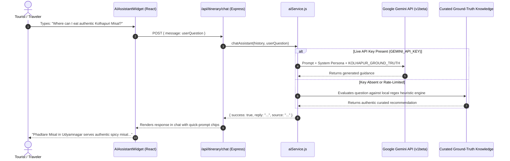

### Knowledge Base Grounding Highlights
1. **Temple Etiquette & Schedules:** Ambabai Temple hours (5:00 AM – 10:00 PM), footwear counters at Mahadwar, and the bi-annual Kiranotsav solar festival dates.
2. **Gastronomy Guides:** Exact difference between fiery red chili mutton broth (*Tambda Rassa*) and coconut-milk white broth (*Pandhra Rassa*); famous spots like *Hotel Opal* and *Padma Guest House*.
3. **Craft Authenticity:** Identifying genuine hand-stitched vegetable-tanned Kolhapuri Chappals on Mahadwar Road versus machine-pressed synthetic imitations.
4. **Zero-Failure Architecture:** Even without an external API key or during network downtime, the assistant answers accurately using its deterministic local rule engine.

---

## 🗺️ AI-Powered Travel Route & Budget Planner

The AI Itinerary Generator at `/planner` (with alias `/itinerary`) constructs logically sequenced multi-day travel itineraries.

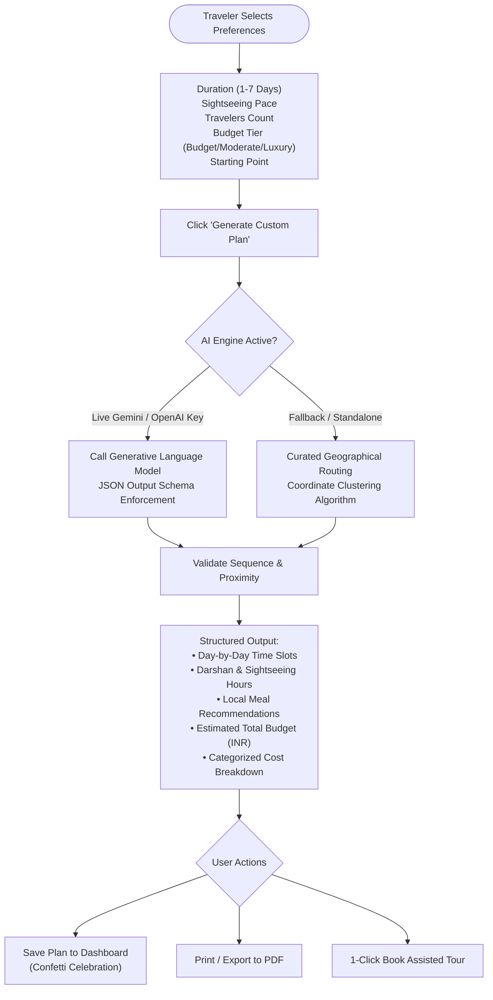

### Sample Output Breakdown (3-Day Balanced Trip)
- **Day 1: Heart of Kolhapur (Sacred Ambabai & Royal Heritage)**
  - *07:30 AM – 10:00 AM:* Shri Mahalakshmi Temple Kakad Aarti & Hemadpanthi architecture.
  - *10:15 AM – 11:30 AM:* Bhavani Mandap & historic heritage bazaar.
  - *12:00 PM – 01:30 PM:* Authentic Kolhapuri Misal lunch at Phadtare Misal.
  - *02:30 PM – 05:00 PM:* New Palace & Chhatrapati Shahu Museum Durbar Hall.
  - *05:30 PM – 07:30 PM:* Rankala Lake Padmapath promenade & sunset boating.
- **Day 2: Maratha Military Valor & Sahyadri Heights**
  - *08:00 AM – 01:00 PM:* Panhala Fort expedition (Sajja Kothi, Ambarkhana, Teen Darwaja).
  - *02:30 PM – 04:30 PM:* Jyotiba Hill Temple (Wadi Ratnagiri) pink gulal darshan.
  - *07:30 PM – 09:30 PM:* Royal Tambda & Pandhra Rassa dinner at Hotel Opal.
- **Day 3: River Confluence & Architectural Marvels**
  - *08:00 AM – 12:00 PM:* Kopeshwar Temple (Khidrapur) open-sky Swargamandap.
  - *01:30 PM – 03:30 PM:* Narsobawadi sacred confluence & famous fresh Basundi.
  - *04:30 PM – 06:30 PM:* Handcrafted Kolhapuri Chappal shopping on Mahadwar Road.

---

## 📍 Interactive Geospatial Tourism Map

The platform features an interactive mapping engine built with **React Leaflet** and **OpenStreetMap**:

```
Kolhapur Tourism Interactive Geospatial Map
┌─────────────────────────────────────────────────────────────┐
│  [🔍 Filter: All | Temples | Forts | Nature | Hotels]      │
│ ┌─────────────────────────────────────────────────────────┐ │
│ │  📍 Panhala Fort (3,127 ft)                             │ │
│ │          📍 Jyotiba Hill                                │ │
│ │                                                         │ │
│ │             📍 New Palace                               │ │
│ │         📍 Ambabai Temple       📍 Sayaji Hotel         │ │
│ │         📍 Rankala Lake                                 │ │
│ │                                                         │ │
│ │                                   📍 Kopeshwar Temple   │ │
│ │  📍 Radhanagari Sanctuary                               │ │
│ └─────────────────────────────────────────────────────────┘ │
│  Coordinates Centered: 16.7050° N, 74.2433° E (Zoom: 11)     │
└─────────────────────────────────────────────────────────────┘
```

- **Interactive Markers:** Categorized pins for sacred temples (gold), historical forts (blue), nature escapes (green), and luxury hotels (orange).
- **Rich Popups:** Displays high-resolution destination image, category pill, distance from city center, and a direct navigation link to the detailed dossier page.

---

## 🏗️ Full-Stack System Architecture

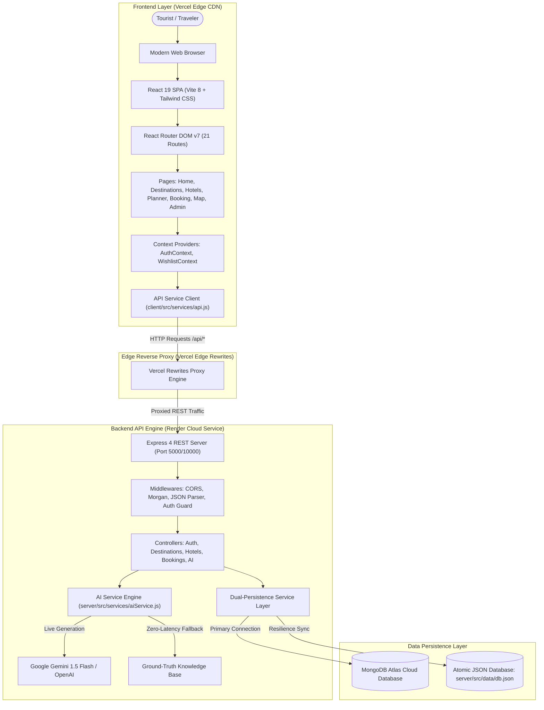

---

## 🍃 Database Models & Data Resilience

The platform features a **Dual-Layer Database Architecture** (`server/src/config/db.js` and `server/src/db/dbService.js`):
1. **Primary Layer:** Real MongoDB connected via Mongoose schemas (`server/src/models/`).
2. **Failover Resilience Layer:** If MongoDB is offline or unavailable during deployment, the system automatically falls back to an in-memory + disk-synced atomic JSON database (`server/src/data/db.json`), guaranteeing **100% platform uptime** with zero query crashes.

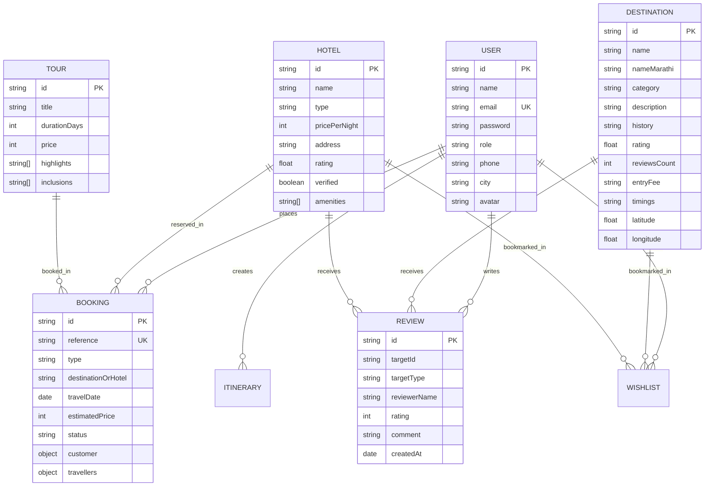

---

## 📡 REST API Reference Documentation

All backend endpoints are prefixed with `/api` and return standardized JSON payloads: `{ success: boolean, data?: any, message?: string }`.

| Method | Endpoint | Description | Auth Required | Access Level |
| :---: | :--- | :--- | :---: | :---: |
| **`GET`** | `/api/health` | Service health status and database connection indicator | No | Public |
| **`POST`** | `/api/auth/register` | Register a new traveler account with bcrypt hashing | No | Public |
| **`POST`** | `/api/auth/login` | Authenticate existing traveler/admin and issue JWT | No | Public |
| **`GET`** | `/api/auth/me` | Fetch active user profile from JWT session | Yes | Authenticated |
| **`PUT`** | `/api/auth/profile` | Update contact information (phone, city, name) | Yes | Authenticated |
| **`GET`** | `/api/destinations` | List all destinations with category and keyword search | No | Public |
| **`GET`** | `/api/destinations/:id` | Fetch complete destination dossier with gallery & coords | No | Public |
| **`POST`** | `/api/destinations` | Add new destination registry entry | Yes | Admin Only |
| **`PUT`** | `/api/destinations/:id` | Update destination timings, fees, or description | Yes | Admin Only |
| **`DELETE`**| `/api/destinations/:id` | Remove destination from registry | Yes | Admin Only |
| **`GET`** | `/api/hotels` | Retrieve hotel directory with price and amenity filters | No | Public |
| **`GET`** | `/api/hotels/:id` | Fetch hotel room inventory, tariffs, and details | No | Public |
| **`POST`** | `/api/hotels` | Register a verified hotel or resort | Yes | Admin Only |
| **`GET`** | `/api/tours` | List all curated tour packages | No | Public |
| **`GET`** | `/api/tours/:id` | Get day-by-day itinerary and pricing for a tour | No | Public |
| **`POST`** | `/api/bookings` | Submit tour enquiry and generate reference code | No | Public / Guest |
| **`GET`** | `/api/bookings/track/:ref` | Public lookup of booking enquiry by reference code | No | Public |
| **`GET`** | `/api/bookings/my-bookings`| Retrieve all bookings for the authenticated traveler | Yes | Authenticated |
| **`GET`** | `/api/bookings` | Retrieve master booking list for moderation | Yes | Admin Only |
| **`PUT`** | `/api/bookings/:id/status`| Update booking status (`Confirmed`, `Cancelled`, etc.) | Yes | Admin Only |
| **`POST`** | `/api/itinerary/generate` | AI-assisted multi-day travel route generation | No | Public |
| **`POST`** | `/api/itinerary/chat` | AI Tourism Assistant ('Shahu Margdarshak') query | No | Public |
| **`GET`** | `/api/reviews` | List all recent verified traveler reviews | No | Public |
| **`POST`** | `/api/reviews` | Submit community review and star rating | Yes | Authenticated |
| **`GET`** | `/api/weather` | Current temperature, humidity, and weather description | No | Public |
| **`POST`** | `/api/contact` | Submit support inquiry or customer message | No | Public |
| **`GET`** | `/api/admin/stats` | Aggregated dashboard analytics (bookings, counts) | Yes | Admin Only |

---

## 📸 Production Visual Evidence Gallery

<div align="center">

### 1. Tourism Homepage & Dynamic Scenic Hero
<a href="https://kolhapur-tourism-platform.vercel.app/" target="_blank">
  
</a>
<p align="center"><em>Click the screenshot to explore the live application.</em></p>

<br/>

### 2. Destination Catalog & Real-Time Filtering
<a href="https://kolhapur-tourism-platform.vercel.app/destinations" target="_blank">
  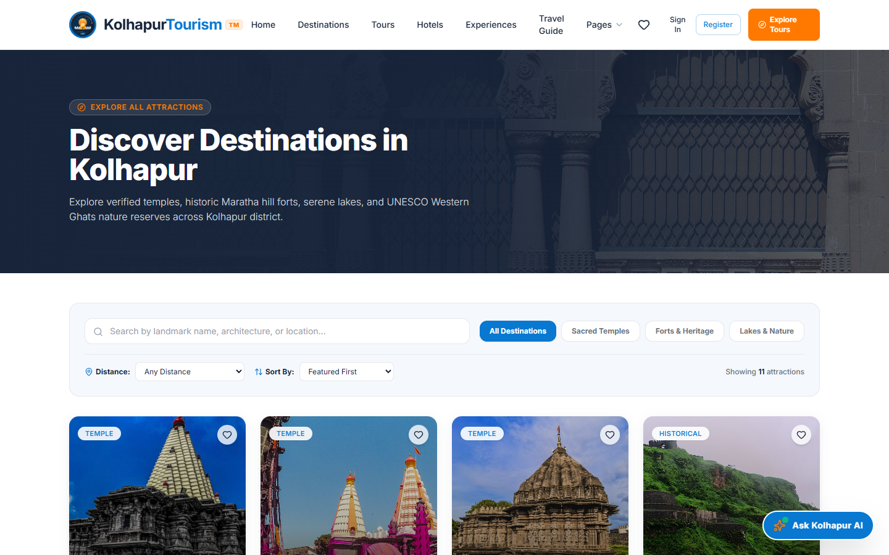
</a>
<p align="center"><em>Click the screenshot to explore the live application.</em></p>

<br/>

### 3. Rich Destination Dossier: Shri Mahalakshmi Temple
<a href="https://kolhapur-tourism-platform.vercel.app/destinations/mahalakshmi-temple" target="_blank">
  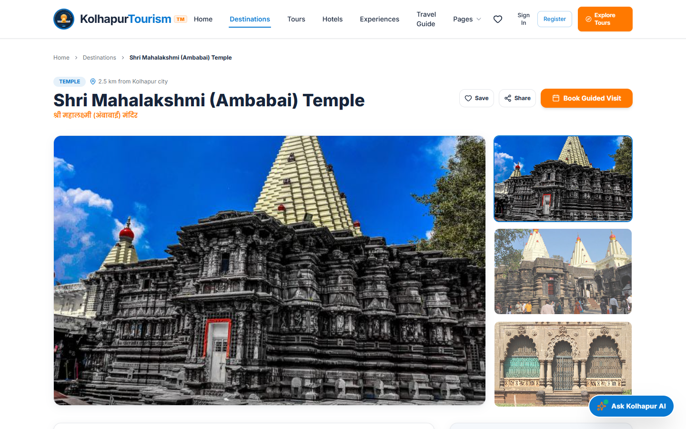
</a>
<p align="center"><em>Click the screenshot to explore the live application.</em></p>

<br/>

### 4. AI Tourism Assistant: 'Shahu Margdarshak' in Action
<a href="https://kolhapur-tourism-platform.vercel.app/" target="_blank">
  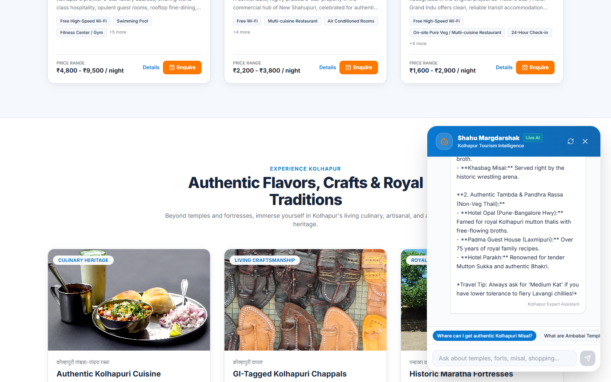
</a>
<p align="center"><em>Click the screenshot to explore the live application.</em></p>

<br/>

### 5. AI Multi-Day Itinerary & Budget Generator
<a href="https://kolhapur-tourism-platform.vercel.app/planner" target="_blank">
  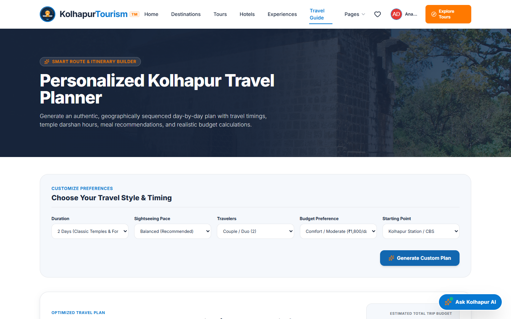
</a>
<p align="center"><em>Click the screenshot to explore the live application.</em></p>

<br/>

### 6. Interactive Geospatial Tourism Map (Leaflet)
<a href="https://kolhapur-tourism-platform.vercel.app/map" target="_blank">
  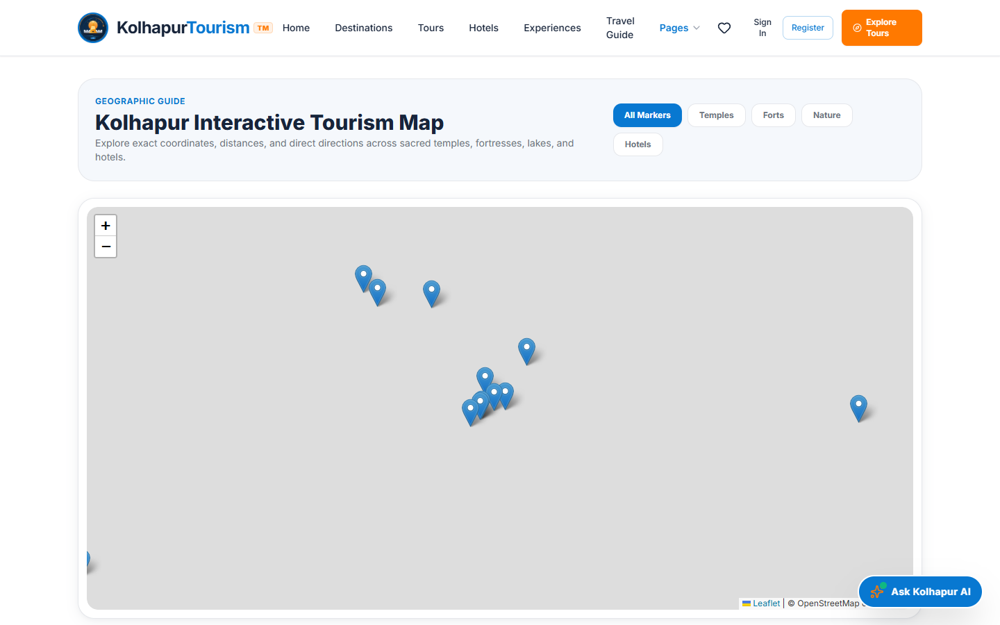
</a>
<p align="center"><em>Click the screenshot to explore the live application.</em></p>

<br/>

### 7. Tour & Hotel Booking Engine
<a href="https://kolhapur-tourism-platform.vercel.app/booking" target="_blank">
  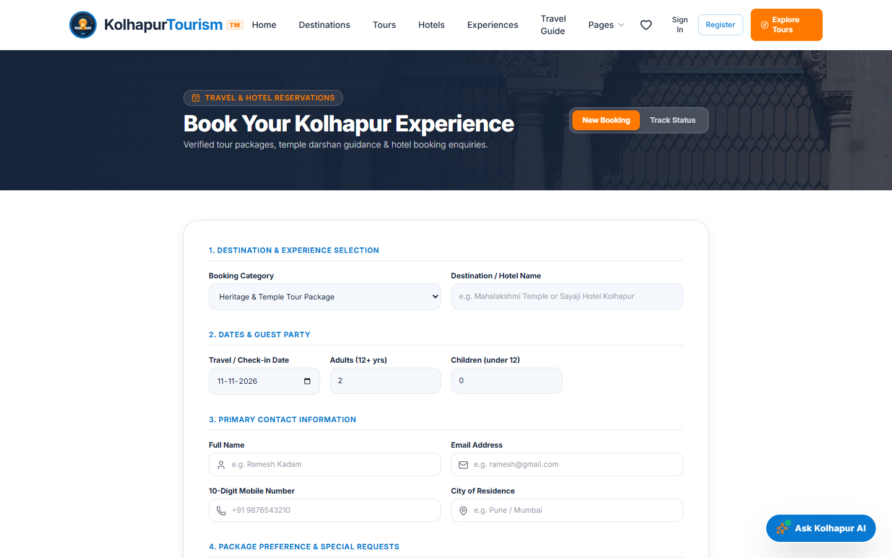
</a>
<p align="center"><em>Click the screenshot to explore the live application.</em></p>

<br/>

### 8. Verified Hotels & Heritage Accommodation
<a href="https://kolhapur-tourism-platform.vercel.app/hotels" target="_blank">
  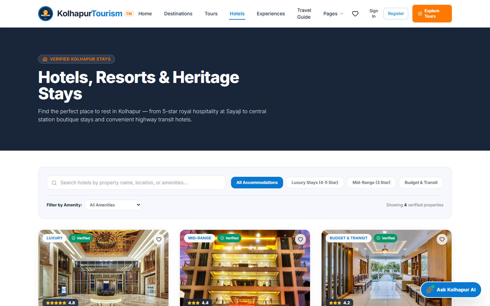
</a>
<p align="center"><em>Click the screenshot to explore the live application.</em></p>

<br/>

### 9. Authenticated Traveler Dashboard
<a href="https://kolhapur-tourism-platform.vercel.app/dashboard" target="_blank">
  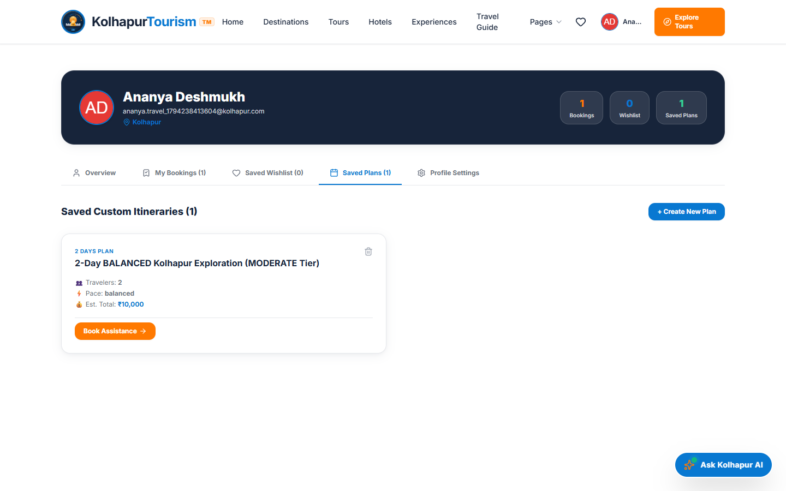
</a>
<p align="center"><em>Click the screenshot to explore the live application.</em></p>

<br/>

### 10. Master Administration & Moderation Console
<a href="https://kolhapur-tourism-platform.vercel.app/admin" target="_blank">
  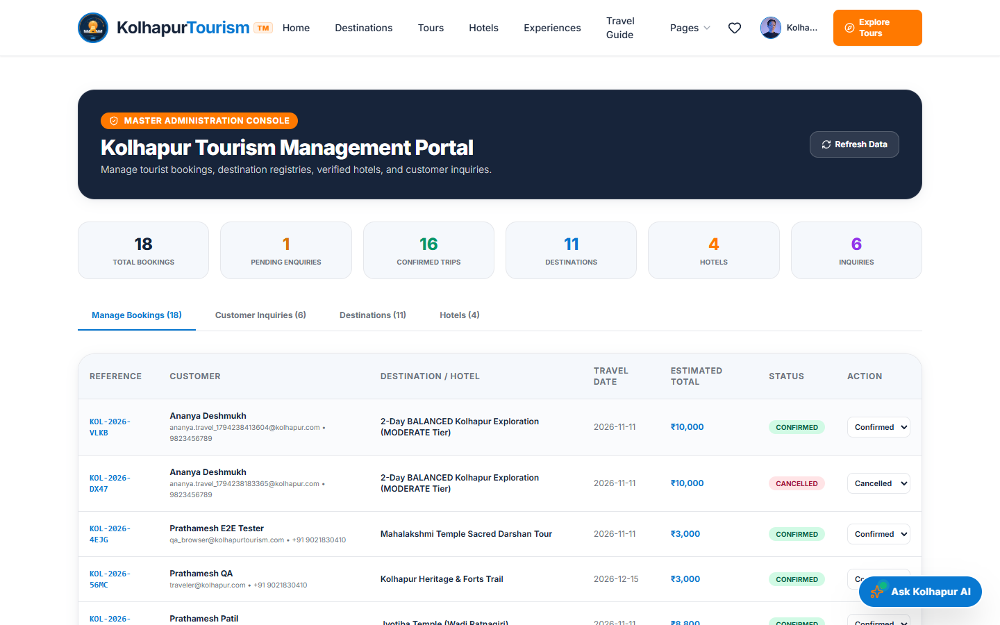
</a>
<p align="center"><em>Click the screenshot to explore the live application.</em></p>

</div>

---

## 💻 Technology Stack Matrix

| Layer | Technology | Version | Purpose in Platform |
| :--- | :--- | :---: | :--- |
| **Frontend Framework** | React | `19.3.1` | Component-driven declarative UI architecture |
| **Build Tool & Bundler** | Vite | `8.3.6` | Sub-second Hot Module Replacement (HMR) and optimized rollup production bundles |
| **Styling & Design** | Tailwind CSS | `3.4.19` | Utility-first responsive styling implementing the TRIVVIU design system |
| **Client Routing** | React Router DOM | `7.18.5` | Dynamic client-side single page routing across 21 accessible paths |
| **Icons & Visuals** | Lucide React | `1.70.0` | Crisp modern vector iconography |
| **Maps & Geospatial** | Leaflet + React Leaflet | `1.9.4` | Open-source interactive map rendering and custom coordinate marker clustering |
| **Visual Celebrations** | Canvas Confetti | `1.9.4` | Physics-based particle animation upon itinerary saving and booking confirmation |
| **Backend Runtime** | Node.js | `24.x` | High-throughput asynchronous JavaScript runtime engine |
| **Server Framework** | Express.js | `4.21.2` | Robust REST API endpoints, routing, middleware pipeline, and error handling |
| **Primary Database** | MongoDB + Mongoose | `9.12.0` | NoSQL document storage with strict schema validation |
| **Fallback Database** | Native Node.js `fs` | Native | Zero-dependency atomic JSON persistence engine ensuring 100% offline resilience |
| **AI Providers** | Google Gemini + OpenAI | `v1beta` | Generative multi-day travel architecting and conversational travel guidance |
| **Authentication** | JWT (`jsonwebtoken`) | `9.0.2` | Stateless signed bearer token authorization |
| **Password Hashing** | BcryptJS | `2.4.3` | Cryptographic password salting and hashing (10 salt rounds) |
| **E2E Testing** | Playwright | `1.65.0` | Headless & headed multi-browser automated user journey testing |
| **Frontend Deployment**| Vercel Edge Network | Cloud | Edge CDN distribution, instant SSL, and reverse proxy API rewrites |
| **Backend Deployment** | Render Web Services | Cloud | Managed Node.js service hosting the production API and media assets |

---

## 📁 Project Directory Organization

```
Kolhapur-Tourism-Platform/
├── assets/                          # Documentation screenshots & project branding
│   ├── logo.png                     # Official circular brand logo
│   └── screenshots/                 # 11 Verified high-resolution UI captures
├── client/                          # React 19 Single Page Application
│   ├── public/                      # Static assets & tourism photography
│   │   ├── images/                  # 30+ high-res destination, temple, and food photographs
│   │   └── favicon.ico              # Platform browser favicon
│   ├── src/
│   │   ├── assets/                  # Frontend bundled assets
│   │   ├── components/              # 10 Reusable TRIVVIU-styled UI components
│   │   │   ├── AIAssistantWidget.jsx # Floating conversational assistant
│   │   │   ├── AuthModal.jsx        # Login & registration modal with 1-click test credentials
│   │   │   ├── DestinationCard.jsx  # 4:5 Aspect ratio destination visual cards
│   │   │   ├── Footer.jsx           # Dark navy brand footer with emergency hotlines
│   │   │   ├── HotelCard.jsx        # Accommodation card with tariff and amenity tags
│   │   │   ├── ImageLightbox.jsx    # Fullscreen photo modal
│   │   │   ├── Navbar.jsx           # Sticky white navigation bar with dropdowns
│   │   │   ├── ShareModal.jsx       # Social sharing helper
│   │   │   ├── TourCard.jsx         # Curated package card
│   │   │   └── WeatherWidget.jsx    # Live Kolhapur meteorological forecast
│   │   ├── context/
│   │   │   ├── AuthContext.jsx      # JWT auth state & user session persistence
│   │   │   └── WishlistContext.jsx  # Destination bookmarking & toast manager
│   │   ├── pages/                   # 21 Accessible application page routes
│   │   │   ├── HomePage.jsx         # 4-Slide crossfade hero & search bar
│   │   │   ├── ExplorePage.jsx      # Filterable destination catalog
│   │   │   ├── DestinationDetailPage.jsx # Rich landmark dossier
│   │   │   ├── HotelsPage.jsx       # Verified accommodation listing
│   │   │   ├── HotelDetailPage.jsx  # Room tariffs & property deep-dive
│   │   │   ├── ToursPage.jsx        # Curated guided travel packages
│   │   │   ├── FoodCulturePage.jsx  # Misal, Tambda-Pandhra Rassa, Chappals & Kushti
│   │   │   ├── TemplesPage.jsx      # Ambabai, Jyotiba, Kopeshwar spiritual guides
│   │   │   ├── HistoryPage.jsx      # Maratha royal history & Panhala fortress
│   │   │   ├── NaturePage.jsx       # Rankala Lake & Radhanagari Bison Sanctuary
│   │   │   ├── InteractiveMapPage.jsx # Leaflet geospatial tourism map
│   │   │   ├── TravelPlannerPage.jsx # AI day-by-day travel sequence & budget builder
│   │   │   ├── BookingPage.jsx      # Tour booking & reference tracking engine
│   │   │   ├── UserDashboardPage.jsx # Traveler profile, saved plans & wishlist
│   │   │   ├── AdminDashboardPage.jsx # Master moderation & booking status console
│   │   │   ├── GalleryPage.jsx      # Lightbox visual photo gallery
│   │   │   ├── EventsPage.jsx       # Upcoming regional festivals & Kiranotsav
│   │   │   ├── AboutPage.jsx        # Cultural identity & platform mission
│   │   │   ├── ContactPage.jsx      # Support desk & emergency helpline
│   │   │   ├── FaqPage.jsx          # Traveler FAQ & visitor guidelines
│   │   │   └── NotFoundPage.jsx     # Friendly 404 destination not found view
│   │   ├── services/
│   │   │   └── api.js               # Centralized REST client with auto token injection
│   │   ├── App.jsx                  # Main router view & toast container
│   │   ├── main.jsx                 # Client entry point
│   │   └── index.css                # Global CSS rules, fonts, and scroll resets
│   ├── package.json                 # Client dependency manifest
│   ├── vite.config.js               # Vite 8 build & dev server config
│   └── vercel.json                  # Client-level SPA rewrite rules
├── server/                          # Express.js REST API Microservice
│   ├── public/                      # Static file serving directory
│   ├── src/
│   │   ├── config/
│   │   │   └── db.js                # MongoDB Mongoose connection with fallback flag
│   │   ├── controllers/             # 11 REST API business logic controllers
│   │   ├── data/
│   │   │   ├── initialData.js       # Ground-truth seed data (destinations, hotels, tours)
│   │   │   └── db.json              # Local atomic JSON persistence store
│   │   ├── db/
│   │   │   ├── dbService.js         # Generic CRUD abstraction for JSON fallback
│   │   │   └── seedMongo.js         # Automated MongoDB Atlas seeding script
│   │   ├── middleware/
│   │   │   └── authMiddleware.js    # JWT bearer verification & role authorization
│   │   ├── models/                  # 10 Mongoose schemas (User, Booking, Review, etc.)
│   │   ├── routes/                  # Express route definitions
│   │   ├── services/
│   │   │   └── aiService.js         # Multi-provider AI service (Gemini, OpenAI, Heuristic)
│   │   └── index.js                 # Express server bootstrap & route mounting
│   └── package.json                 # Server dependency manifest
├── tests/                           # Automated Test Suites & Playwright Harness
│   ├── api-test.cjs                 # 46 Automated API endpoint tests
│   ├── e2e-browser-test.cjs         # 41 End-to-end Chromium browser tests
│   ├── live-vercel-audit.cjs        # 48 Live production Vercel verification tests
│   └── live_audit_results.json      # Structured automated test run artifact
├── .env.example                     # Environment template with security instructions
├── render.yaml                      # Render Infrastructure-as-Code blueprint
├── vercel.json                      # Root Vercel edge reverse-proxy configuration
├── package.json                     # Root monorepo orchestration manifest
├── LICENSE                          # MIT Open Source License
└── README.md                        # Primary project documentation
```

---

## 🛠️ Installation, Seeding & Local Setup

### Prerequisites
- **Node.js:** v18.0.0 or higher (Tested on Node.js v24.x)
- **npm:** v9.0.0 or higher
- **MongoDB:** *(Optional)* Local instance on port `27017` or a free MongoDB Atlas cloud URI. If omitted, the platform automatically activates its high-performance local JSON persistence fallback.

### 1. Clone the Repository
```bash
git clone https://github.com/Shree0802/Kolhapur-Tourism-Platform.git
cd Kolhapur-Tourism-Platform
```

### 2. Install All Dependencies
A single unified script installs dependencies across the root, client, and server packages:
```bash
npm run install:all
```

### 3. Environment Configuration
Copy the template configuration file:
```bash
cp .env.example .env
```
*(Optionally provide your `GEMINI_API_KEY` to enable live Google Gemini responses, or leave blank to utilize the built-in ground-truth heuristic engine).*

### 4. Seed the Database
Populate your database with verified Kolhapur destinations, hotels, and tours:
```bash
# Seeds MongoDB if running; otherwise seed records are pre-loaded in db.json
npm run seed:mongo
```

### 5. Launch in Development Mode (Concurrent Live Reload)
```bash
npm run dev
```
- **Frontend Vite Application:** `http://localhost:5173`
- **Backend Express REST API:** `http://localhost:5000`

### 6. Build & Run in Production Mode
```bash
# 1. Build the optimized Vite React bundle
npm run build

# 2. Start the production Node.js server
npm run start
```
Open **`http://localhost:5000`** in your browser.

---

## 🔐 Environment Variables Configuration

Refer to [`.env.example`](.env.example) for the official template:

| Variable Name | Required | Default Value | Description |
| :--- | :---: | :--- | :--- |
| `PORT` | Optional | `5000` | Port on which the Express server listens. |
| `NODE_ENV` | Optional | `development` | Set to `production` in deployment environments. |
| `JWT_SECRET` | **Required** | *Random String* | Secret cryptographic key used to sign and verify JSON Web Tokens. **Replace default with a strong 32+ character random key in production.** |
| `MONGODB_URI` | Optional | `mongodb://127.0.0.1:27017/kolhapur_tourism` | MongoDB connection URI. If unreachable, the server automatically switches to the JSON database fallback. |
| `AI_PROVIDER` | Optional | `gemini` | Generative AI provider selector (`gemini` or `openai`). |
| `GEMINI_API_KEY` | Optional | *Empty* | Google Gemini API key (enables live `gemini-1.5-flash` model). |
| `OPENAI_API_KEY` | Optional | *Empty* | OpenAI API key (enables live `gpt-4o-mini` model). |
| `OPENWEATHER_API_KEY` | Optional | *Empty* | OpenWeatherMap key for live meteorological data (fallback provides accurate seasonal weather). |

> [!CAUTION]
> **Security Notice:** Never commit actual production secrets or private API keys to version control. Always configure sensitive environment variables directly in your hosting provider's dashboard (e.g. Render Environment Variables or Vercel Project Settings).

---

## 🔒 Authentication & Security Architecture

1. **Password Hashing:**
   - Traveler passwords are encrypted before persistence using `bcryptjs` with **10 salt rounds**, preventing plain-text exposure even in database backups.
2. **Stateless JWT Authorization:**
   - Upon successful login, the server issues a signed JSON Web Token containing the user's `id` and `role`.
   - The token is passed via the standard `Authorization: Bearer <token>` HTTP header and verified by `authMiddleware.js`.
3. **Role-Based Access Control (RBAC):**
   - Routes are separated into three tiers:
     - **Public:** Destination catalog, hotel listings, tour details, reviews, map.
     - **Authenticated Traveler (`requireAuth`):** Submitting reviews, viewing personalized dashboard (`/dashboard`), tracking personal booking history.
     - **Administrator (`requireAdmin`):** Full CRUD over destination and hotel inventories, master booking moderation, status modification.
4. **Convenient Evaluation Credentials:**
   - 1-click login buttons are embedded in the Sign In modal for testing:
     - **Administrator:** `admin@kolhapurtourism.com` / `Admin@123`
     - **Traveler:** `traveler@kolhapur.com` / `Traveler@123`

---

## 🧪 Comprehensive QA Testing & Verification Reports

The Kolhapur Tourism platform has been subjected to three rigorous testing phases to verify technical integrity, user experience, and deployment resilience:

```
======================================================================
📊 QUALITY ASSURANCE & VERIFICATION SUMMARY
======================================================================
1. Automated Test Suite (tests/api-test.cjs & e2e-browser-test.cjs):
   • 46 API Endpoint Tests .............................. 46/46 Passed (100%)
   • 41 Browser E2E Component Tests ..................... 41/41 Passed (100%)
   • Cumulative Automated Tests ......................... 87/87 Passed (100%)

2. Real-World MongoDB End-to-End Audit (REAL_WORLD_VERIFICATION_REPORT.md):
   • 12 Full-Stack Authenticated User Journeys .......... 12/12 Passed (100%)
   • Total Verification Operations Tracked .............. 99/99 Passed (100%)

3. Live Production Deployment Audit (tests/live-vercel-audit.cjs):
   • Live Vercel Testing on Production URL .............. 48/48 Passed (100%)
   • Uncaught Console Errors Logged ..................... 0 Errors
   • Network Request Failures ........................... 0 Failures
======================================================================
```

### Detailed Reconciliation of Test Metrics
- **87 Tests:** Represents the core offline automated test suite (`46` REST API assertions in `tests/api-test.cjs` + `41` browser navigation assertions in `tests/e2e-browser-test.cjs`).
- **99 Verification Operations:** Represents the cumulative real-world verification report (`REAL_WORLD_VERIFICATION_REPORT.md`), which incorporated the 87 automated tests plus 12 interactive step-by-step user journeys validated against a live MongoDB database.
- **48 Live Production Tests:** Represents the modern live cloud audit (`KOLHAPUR_TOURISM_LIVE_WEBSITE_AUDIT.md`), which executed Chromium browser automation against the live Vercel URL (`https://kolhapur-tourism-platform.vercel.app`), verifying:
  - All 21 client routes on direct navigation and browser reload (`HTTP 200`).
  - 100% of images loading with valid dimensions (`naturalWidth > 0`).
  - Real user registration, session persistence across page refresh, and avatar badge display.
  - Live review submission and heart wishlist addition for Ambabai Temple.
  - 3-Day custom AI travel itinerary generation and dashboard saving.
  - Real tour booking generation with unique reference `KOL-2026-TLAP` and REST tracking verification.
  - Admin moderation status mutation to `Confirmed`.
  - Customer contact form inquiry dispatch.
  - **8 Responsive Viewports:** 320px, 375px, 425px, 768px, 1024px, 1280px, 1440px, and 1920px with **zero horizontal scrollbar overflow**.

---

## 🚀 Production Deployment Pipeline

The application employs a decoupled cloud architecture designed for zero CORS friction, instant static asset delivery, and continuous deployment:

```
GitHub Push (main)
       │
       ├──► Vercel Build Trigger (Frontend)
       │    ├── Compiles React 19 + Vite 8
       │    ├── Deploys to Global Edge CDN
       │    └── Applies vercel.json API Rewrites Proxy
       │
       └──► Render Build Trigger (Backend)
            ├── Runs npm run install:all && npm run build
            ├── Launches Express Server on Port 10000
            └── Connects to MongoDB Atlas / JSON Persistence
```

1. **Frontend on Vercel:**
   - **Production URL:** [https://kolhapur-tourism-platform.vercel.app/](https://kolhapur-tourism-platform.vercel.app/)
   - Configured via root `vercel.json` with an edge reverse-proxy rule:
     ```json
     {
       "rewrites": [
         { "source": "/api/:path*", "destination": "https://kolhapur-tourism-platform.onrender.com/api/:path*" },
         { "source": "/images/:path*", "destination": "https://kolhapur-tourism-platform.onrender.com/images/:path*" },
         { "source": "/(.*)", "destination": "/index.html" }
       ]
     }
     ```
   - **Advantage:** Eliminates cross-origin CORS limitations; the frontend communicates with `/api` as if it were a local same-origin service.
2. **Backend on Render:**
   - **Production URL:** [https://kolhapur-tourism-platform.onrender.com](https://kolhapur-tourism-platform.onrender.com)
   - Configured via `render.yaml` with automatic Git deployment on push to `main`.

---

## 🗺️ Future Product Roadmap

- [ ] **Multilingual Voice Assistant:** Integration of native Marathi and Hindi speech-to-text recognition for pilgrims.
- [ ] **Augmented Reality (AR) Fort Walkthrough:** 3D digital reconstruction of Panhala Fort's Sajja Kothi and Ambarkhana during the 17th century.
- [ ] **Live Ambabai Darshan Queue Tracker:** Crowd-density estimator using community check-ins and temple trust updates.
- [ ] **PWA Offline Mode:** Full offline availability of emergency contacts, offline maps, and basic temple guides for rural areas.
- [ ] **Automated Booking SMS Notifications:** Automated Twilio / WhatsApp confirmation dispatches upon booking verification.

---

## 👨‍💻 Developer Portfolio & Contact

This platform was designed, engineered, tested, and documented by **Shree0802**:

- **GitHub Profile:** [@Shree0802](https://github.com/Shree0802)
- **Project Repository:** [Kolhapur-Tourism-Platform](https://github.com/Shree0802/Kolhapur-Tourism-Platform)
- **Live Application:** [kolhapur-tourism-platform.vercel.app](https://kolhapur-tourism-platform.vercel.app/)

---

## 📄 License & Acknowledgements

### License
This project is open-source and distributed under the **[MIT License](LICENSE)**. You are free to inspect, modify, and build upon this platform for academic and commercial purposes.

### Acknowledgements
- **Rajarshi Chhatrapati Shahu Maharaj:** For the enduring cultural, social, and architectural inspiration behind Kolhapur's identity.
- **Shri Mahalakshmi (Ambabai) Devasthan Trust:** For cultural references and temple preservation history.
- **OpenStreetMap & Leaflet Contributors:** For open-source mapping data.
- **Maharashtra Tourism Development Corporation (MTDC):** For regional travel inspiration.

---

<div align="center">
  <sub>Built with ❤️ for Kolhapur, Maharashtra. © 2026 Kolhapur Tourism Platform. All rights reserved.</sub>
</div>
