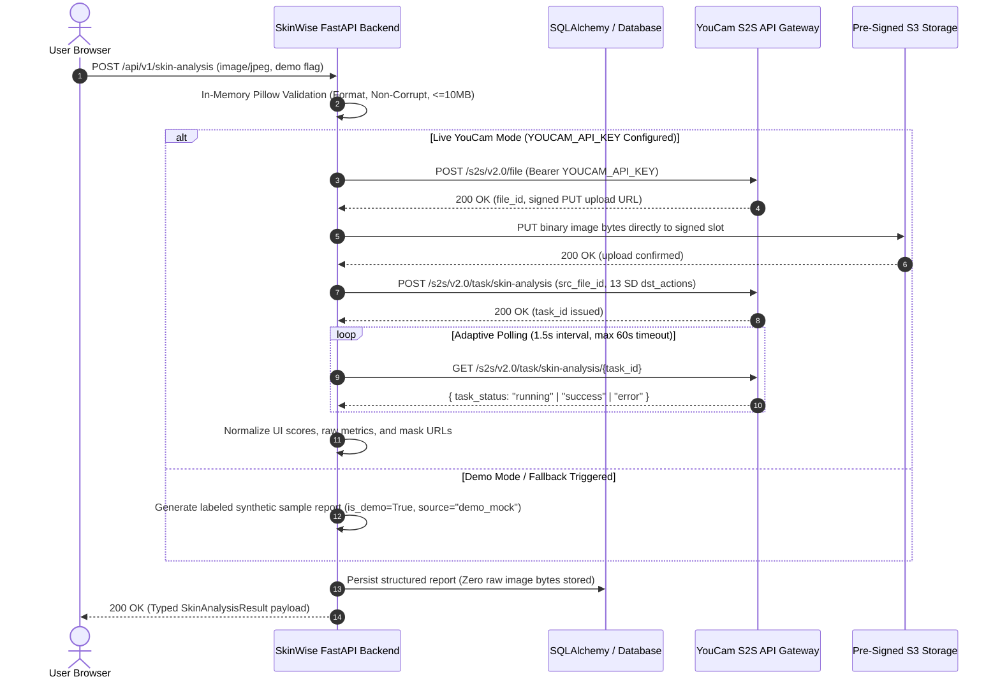

<div align="center">

# 🌿 SkinWise AI

### **Explainable Skincare Decision Assistant**
*Empirical Facial Computer Vision Diagnostics • Transparent Cosmetic Routines • Smart Shopping in ₹ INR*

[](https://skin-wise-ai-main.vercel.app)
[](https://skinwiseai-main.onrender.com)
[](https://skinwiseai-main.onrender.com/docs)
[](https://skinwiseai-main.onrender.com/api/v1/health)

<br/>

[](https://devpost.com)
[](https://fastapi.tiangolo.com)
[](https://react.dev)
[](https://vitejs.dev)
[](https://tailwindcss.com)
[](https://pytest.org)
[](https://vitest.dev)
[](https://oxc.rs)
[](https://github.com/Shree0802/SkinWiseAI-main)

<br/>

**"Understand Your Skin. Build Better Routines. Make Smarter Skincare Decisions."**

[Explore Live Web App](https://skin-wise-ai-main.vercel.app) • [View API Documentation](https://skinwiseai-main.onrender.com/docs) • [API Readiness Probe](https://skinwiseai-main.onrender.com/api/v1/health) • [Report Issue](https://github.com/Shree0802/SkinWiseAI-main/issues)

</div>

---

## 📑 Table of Contents

- [🌿 Executive Overview](#-executive-overview)
- [⚠️ The Problem: Why Skincare Consumers Need Clarity](#️-the-problem-why-skincare-consumers-need-clarity)
- [💡 The SkinWise Solution](#-the-skinwise-solution)
- [🌟 Key Features & Technical Highlights](#-key-features--technical-highlights)
  - [1. Enterprise YouCam Skin AI Integration (S2S v2.0)](#1-enterprise-youcam-skin-ai-integration-s2s-v20)
  - [2. Zero-Fabrication Metric Transparency Policy](#2-zero-fabrication-metric-transparency-policy)
  - [3. Deterministic AM/PM Skincare Routine Builder](#3-deterministic-ampm-skincare-routine-builder)
  - [4. Explainable Product Match & Shopping (₹ INR)](#4-explainable-product-match--shopping--inr)
  - [5. Side-by-Side Product Comparison Drawer](#5-side-by-side-product-comparison-drawer)
  - [6. Skin Progress Journal & Diagnostic History](#6-skin-progress-journal--diagnostic-history)
  - [7. Privacy-First Ephemeral In-Memory Pipeline](#7-privacy-first-ephemeral-in-memory-pipeline)
- [📸 Application Walkthrough & Visual Tour](#-application-walkthrough--visual-tour)
- [🏗️ System Architecture](#️-system-architecture)
  - [High-Level Component Architecture](#high-level-component-architecture)
  - [Server-to-Server YouCam Protocol Flow](#server-to-server-youcam-protocol-flow)
- [🔄 Application Workflows: Live vs. Demo Mode](#-application-workflows-live-vs-demo-mode)
- [🛠️ Technology Stack](#️-technology-stack)
- [📂 Project Directory Structure](#-project-directory-structure)
- [💻 Installation & Local Setup (Windows PowerShell)](#-installation--local-setup-windows-powershell)
- [🌐 RESTful API Reference](#-restful-api-reference)
- [🧪 Testing & Quality Assurance](#-testing--quality-assurance)
- [☁️ Production Deployment Guide](#️-production-deployment-guide)
  - [Frontend Deployment (Vercel)](#frontend-deployment-vercel)
  - [Backend Deployment (Render)](#backend-deployment-render)
- [🔒 Security & Privacy Practices](#-security--privacy-practices)
- [🚀 Roadmap & Future Enhancements](#-roadmap--future-enhancements)
- [⚖️ License & Medical Disclaimer](#️-license--medical-disclaimer)

---

## 🌿 Executive Overview

**SkinWise AI** is an explainable skincare decision assistant engineered for the **YouCam API Skin AI & eCommerce VTO Hackathon** on Devpost. 

Modern skincare consumers are bombarded with confusing chemical percentages (BHA, AHA, Retinoids, Niacinamide, Azelaic Acid, Peptides) and aggressive marketing hype. Without clinical expertise, users routinely damage their skin barrier by layering incompatible active ingredients or waste significant money on products unsuited to their skin profile.

SkinWise AI replaces marketing guesswork with **objective facial computer vision diagnostics**, **transparent rule-based cosmetic routines**, and **explainable product shopping tailored to Indian consumers in Indian Rupees (₹)**.

```
       [ Facial Selfie ] ──> ( In-Memory Validation & Pillow Stream )
                                            │
                                            ▼
           [ Server-to-Server YouCam Skin AI API (v2.0 Asynchronous Queue) ]
                                            │
               ┌────────────────────────────┴───────────────────────────┐
               ▼                                                        ▼
   [ Diagnostic Health Map ]                              [ Explainable Decision Engine ]
   • 13 Verified Concerns                                 • AM/PM Regimen with Step Rationales
   • Vitality Score & Skin Age                            • Multi-Vector Product Matching (₹ INR)
   • Computer Vision Mask Overlays                        • 48-Hour Patch-Test Safety Guidance
```

---

## ⚠️ The Problem: Why Skincare Consumers Need Clarity

1. **Active Ingredient Overload & Barrier Damage**: Consumers mix incompatible active formulations (e.g. combining direct acids with retinoids), triggering erythema, contact dermatitis, and micro-tears.
2. **Black-Box AI Hallucinations**: Generic LLMs routinely output unverified skincare advice, invent imaginary concentrations, and offer zero safety bounds or disclaimers.
3. **Price Disconnect & Currency Confusion**: Most global skincare apps cater exclusively to US/EU markets with foreign pricing ($/€), ignoring accessible, high-efficacy Indian brands (Minimalist, Derma Co, Plum, Re'equil).
4. **Biometric Privacy Exploitation**: Many mobile beauty apps upload and persistently store high-resolution facial images on private servers or monetize personal biometric photos.

---

## 💡 The SkinWise Solution

SkinWise AI addresses these challenges with a deterministic, privacy-centric engineering philosophy:

- **Empirical Diagnostics**: Integrates Perfect Corp's enterprise **YouCam Skin AI API** to assess 13 dermatological indicators via deep learning.
- **Explainability Over Generative Guesswork**: Every routine step and product recommendation is computed via a transparent scoring algorithm that provides human-readable rationales.
- **Zero Selfie Retention**: Raw facial images are validated in RAM, streamed ephemerally to YouCam's secure pipeline, and discarded immediately after processing. Zero photos touch persistent disks.
- **Localized for India**: Curated formulations with transparent pricing in Indian Rupees (₹) and targeted routines suited for diverse Indian climates.

---

## 🌟 Key Features & Technical Highlights

### 1. Enterprise YouCam Skin AI Integration (S2S v2.0)
Implements Perfect Corp's official enterprise Server-to-Server asynchronous processing workflow:
- **Phase 1: Pre-Signed Slot Acquisition**: Calls `POST /s2s/v2.0/file` to register image metadata and receive an authorized pre-signed S3 upload URL.
- **Phase 2: Secure Binary Upload**: Streams binary image bytes directly to the pre-signed storage slot via HTTP `PUT` with validated MIME headers.
- **Phase 3: Task Initiation**: Dispatches `POST /s2s/v2.0/task/skin-analysis` with 13 official Standard Definition (SD) diagnostic actions:
  `wrinkle`, `pore`, `texture`, `acne`, `age_spot`, `redness`, `oiliness`, `moisture`, `dark_circle_v2`, `eye_bag`, `skin_type`, `radiance`, `firmness`.
- **Phase 4: Bounded Backoff Polling**: Polls `GET /s2s/v2.0/task/skin-analysis/{task_id}` with an adaptive 1.5s interval, rate-limit backoff handling, and a strict 60s timeout barrier.
- **Phase 5: Facial Landmark Sizing Guard**: Validates that the input image contains a centered portrait occupying at least 60% of the image width, delivering actionable user guidance instead of unhandled server failures.

### 2. Zero-Fabrication Metric Transparency Policy
- **No Hallucinated Scores**: If the YouCam AI model does not return a specific metric (e.g. eye bags or firmness due to lighting or occlusion), SkinWise AI **never invents or guesses a score**. Unreturned fields remain transparently flagged as unassessed.
- **Honest Severity Categorization**: Scores are standardized to a 0–100 scale:
  - `80–100`: **Optimal** (High vitality, low concern)
  - `65–79`: **Mild Concern** (Maintenance and preventive care)
  - `45–64`: **Moderate Concern** (Active targeted care recommended)
  - `< 45`: **Needs Targeted Care** (Barrier recovery and prioritized active support)
- **Computer Vision Mask Overlays**: Renders authentic Alpha Mask coordinate URLs returned by YouCam directly over facial diagnostic cards.

### 3. Deterministic AM/PM Skincare Routine Builder
A science-backed rule formulation engine constructing balanced daily regimens:
- **Morning (AM) Regimen**: Protects against environmental oxidants and UV radiation (Gentle Cleanser → Hydrating Essence → Antioxidant / Sebum Regulator → Barrier Moisturizer → Broad-Spectrum SPF 50 PA++++).
- **Evening (PM) Regimen**: Promotes cellular renewal and barrier recovery (Double Cleansing / Purifying Wash → Targeted Exfoliant or Retinoid → Soothing Barrier Cream).
- **Minimalist Preference Toggle**: Allows users to collapse routines down to a core 3-step essential routine.
- **Safety Safeguards**: Accompanied by prominent medical disclaimers and step-by-step **48-Hour Patch-Test Guidelines**.

### 4. Explainable Product Match & Shopping (₹ INR)
A curated catalogue of Indian skincare products featuring key actives, full ingredient listings, and price points in Indian Rupees (₹):
- **Explainable Multi-Vector Match Formula**:
  $$\text{Match Score} = \text{Baseline}(20) + \text{SkinTypeMatch}(30) + \sum \text{ConcernMatches}(15/\text{each}) + \text{BudgetMatch}(15) + \text{FragranceFree}(10)$$
- **Ingredient Avoidance Filter**: Users can specify ingredients to avoid (e.g., *Fragrance*, *Alcohol Denat*, *Essential Oils*). If detected, the product is immediately disqualified.
- **Human-Readable Match Reasons**: Every product card displays explicit reasons explaining why it matched the user's specific diagnostic profile.

### 5. Side-by-Side Product Comparison Drawer
- Interactive comparison drawer allowing users to compare up to 3 products concurrently.
- Compares price per unit, key active concentrations, target concerns, suitability tags, and full ingredient transparency side-by-side.

### 6. Skin Progress Journal & Diagnostic History
- Record daily observations: skin feel rating (*Great*, *Good*, *Normal*, *Irritated*, *Breakout*), products applied, and qualitative notes.
- Link journal entries directly to YouCam diagnostic scan reports to monitor improvements over time.
- Fully GDPR-compliant data ownership: Users can delete diagnostic reports or journal entries with instant cascade deletion.

### 7. Privacy-First Ephemeral In-Memory Pipeline
- **Zero Facial Disk Retention**: Raw selfie bytes are processed in transient RAM and never written to server disks, persistent filesystems, or cloud buckets.
- **In-Memory Image Validation**: Rigorous verification via Pillow (`PIL.Image.open` + `Image.verify()`), rejecting corrupted files, empty payloads, and disguised non-image files before any external network transfer.
- **Secret Sanitization**: All error handlers and logger wrappers automatically scrub API keys and Bearer tokens to eliminate credential leakage.

---

## 📸 Application Walkthrough & Visual Tour

SkinWise AI features an accessible design system with warm cream backgrounds (`#FAF8F5`), soft lavender accents (`#7E69AB`), and clean typography.

```
+---------------------------------------------------------------------------------------------------------+
|                                        APPLICATION PAGE OVERVIEW                                        |
+-------------------+-------------------------------------------------------------------------------------+
| Page              | Key Features & Interactive Controls                                                 |
+-------------------+-------------------------------------------------------------------------------------+
| 1. Landing Hero   | Value proposition, 3-step interactive roadmap, accuracy guidelines, "Analyze" CTA |
| 2. Skin Analysis  | Drag & drop upload, framing guidelines (>60% width), demo toggle, explicit consent  |
| 3. Diagnostics    | Overall vitality score, skin age, concern severity cards, YouCam mask overlays      |
| 4. Routine Engine | Tailored AM/PM regimens, active ingredient explanations, 48-hr patch test modal     |
| 5. Smart Shop (₹) | Indian skincare catalogue in ₹ INR, multi-vector match scores, ingredient filters   |
| 6. Comparison     | Floating drawer comparing up to 3 products side-by-side across key parameters       |
| 7. Skin Journal   | Longitudinal observations, skin feel tracking, linked diagnostic scans, deletion    |
+-------------------+-------------------------------------------------------------------------------------+
```

> 💡 **Devpost Screenshot Reference Guide**:
> Complete screenshot assets can be captured following the checklist in [docs/SCREENSHOT_CHECKLIST.md](file:///C:/Users/Prathamesh/SkinWiseAI-main/docs/SCREENSHOT_CHECKLIST.md) (`01_landing_hero.png` through `10_automated_tests_pass.png`). The primary brand hero graphic is located at [frontend/src/assets/hero.png](file:///C:/Users/Prathamesh/SkinWiseAI-main/frontend/src/assets/hero.png).

---

## 🏗️ System Architecture

### High-Level Component Architecture

```mermaid
graph TD
    subgraph Client["Client Tier (User Browser)"]
        UI["React 19 + TypeScript + Vite SPA"]
        Router["React Router v7"]
        State["Client State & Comparison Drawer"]
        APIClient["apiClient.ts (Auto /api/v1 Normalization, Timeouts)"]
    end

    subgraph Backend["Application Tier (FastAPI on Render)"]
        FastAPI["FastAPI 0.110+ ASGI Engine"]
        CORS["CORS Middleware (Explicit Origins Only)"]
        Val["Pillow In-Memory Byte Validation"]
        
        subgraph Services["Core Domain Services"]
            YC["YouCamClient (S2S Pipeline & Polling)"]
            RE["RoutineEngine (Deterministic Formulation)"]
            CS["CatalogService (Multi-Vector Matcher)"]
        end
        
        Sanitize["Secret Sanitizer (Credential Scrubbing)"]
    end

    subgraph Data["Persistence Tier"]
        DB[(SQLite / PostgreSQL Engine)]
        Reports[("analysis_reports (Structured Scores Only)")]
        Journal[("journal_entries (User Progress Notes)")]
    end

    subgraph External["External Cloud Infrastructure"]
        YouCamAPI["Perfect Corp YouCam S2S API v2.0"]
        S3Bucket["Pre-Signed Cloud Storage Bucket"]
    end

    UI --> Router
    Router --> State
    State --> APIClient
    APIClient -->|HTTPS / REST| FastAPI

    FastAPI --> CORS
    CORS --> Val
    Val --> Services

    YC -->|1. POST /s2s/v2.0/file| YouCamAPI
    YC -->|2. PUT binary image bytes| S3Bucket
    YC -->|3. POST /s2s/v2.0/task/skin-analysis| YouCamAPI
    YC -->|4. GET /task/skin-analysis/{id} (Poll)| YouCamAPI

    Services --> Sanitize
    Services --> DB
    DB --> Reports
    DB --> Journal
```

### Server-to-Server YouCam Protocol Flow



---

## 🔄 Application Workflows: Live vs. Demo Mode

SkinWise AI operates with transparent mode segregation to ensure smooth operation during hackathon evaluation, local development, and production:

| Workflow Characteristic | Live YouCam API Mode | Demo / Sample Mode |
|:---|:---|:---|
| **Activation Condition** | Valid `YOUCAM_API_KEY` present + Demo checkbox unchecked | Checkbox checked OR API key unconfigured with `ALLOW_DEMO_FALLBACK=True` |
| **External Network Calls** | Complete S2S workflow (`/file` -> S3 upload -> `/task` -> polling) | Zero external network calls; processes entirely locally |
| **Data Provenance** | Real deep-learning computer vision facial analysis | Clearly labeled synthetic data (`is_demo=True`, `source="demo_mock"`) |
| **YouCam AI Mask Overlays** | Real Alpha Mask coordinates generated by YouCam AI | Synthetic illustrative metric previews |
| **Quota Consumption** | Consumes YouCam API subscription credits | 0 API credits consumed (unlimited free testing) |
| **Integrity Assurance** | Full zero-fabrication metric enforcement | Never claims synthetic sample data is real biometric analysis |

---

## 🛠️ Technology Stack

### Frontend Architecture
- **Core Framework**: [React 19](https://react.dev) (`^19.3.1`) — Modern functional components with hooks.
- **Language**: [TypeScript](https://www.typescriptlang.org) (`~6.0.3`) — Comprehensive end-to-end type safety.
- **Build System**: [Vite 8.3](https://vitejs.dev) — Lightning-fast HMR and optimized tree-shaken production bundles.
- **Routing**: [React Router v7](https://reactrouter.com) (`^7.18.4`) — Client-side SPA routing with full Vercel rewrite support.
- **Styling**: [Tailwind CSS 3.4](https://tailwindcss.com) — Utility-first responsive design system.
- **Iconography**: [Lucide React](https://lucide.dev) (`^1.61.0`) — Accessible vector UI icons.
- **Testing & Quality**: [Vitest 4.1](https://vitest.dev) + [Oxlint 1.88](https://oxc.rs) — Sub-second unit testing and high-speed linting.

### Backend Architecture
- **Framework**: [FastAPI](https://fastapi.tiangolo.com) (`>=0.110.0`) — High-performance async ASGI Python web framework.
- **ASGI Server**: [Uvicorn Standard](https://www.uvicorn.org) (`>=0.28.0`) — Production-grade async server.
- **Validation & Settings**: [Pydantic v2](https://docs.pydantic.dev) (`>=2.6.0`) & [Pydantic Settings](https://docs.pydantic.dev/latest/concepts/pydantic_settings/) (`>=2.2.0`).
- **HTTP Client**: [HTTPX](https://www.python-httpx.org) (`>=0.27.0`) — Fully asynchronous HTTP client for external S2S calls.
- **Image Validation**: [Pillow](https://python-pillow.org) (`>=10.0.0`) — Memory-only image stream verification.
- **Database ORM**: [SQLAlchemy 2.0](https://www.sqlalchemy.org) (`>=2.0.28`) — Declarative models with connection pooling.
- **Testing**: [Pytest](https://pytest.org) (`>=8.1.0`) + [pytest-asyncio](https://github.com/pytest-dev/pytest-asyncio) (`>=0.23.5`).

### Database & Deployment
- **Local Database**: [SQLite](https://www.sqlite.org) (`sqlite:///./skinwise.db`) with zero external service dependencies.
- **Production Database**: [PostgreSQL](https://www.postgresql.org) compatible with dynamic connection pooling (`pool_pre_ping`, `pool_recycle`).
- **Frontend Hosting**: [Vercel](https://vercel.com) — Edge CDN with automatic SPA rewrites (`vercel.json`).
- **Backend Hosting**: [Render](https://render.com) — Linux container web service with dynamic `$PORT` binding.

---

## 📂 Project Directory Structure

```
SkinWiseAI-main/
│
├── frontend/                               # React 19 + TypeScript + Vite Client
│   ├── public/                             # Static public assets (favicon.svg, icons.svg)
│   ├── src/
│   │   ├── assets/                         # Graphic assets (hero.png, brand artwork)
│   │   ├── components/                     # Reusable UI component modules
│   │   │   ├── ComparisonDrawer.tsx        # Multi-product side-by-side comparison drawer
│   │   │   ├── DemoModeBadge.tsx           # Transparent demo mode status pill
│   │   │   ├── DisclaimerBanner.tsx        # Cosmetic and medical safety banner
│   │   │   ├── Footer.tsx                  # Application footer with resource links
│   │   │   ├── MetricCard.tsx              # Diagnostic card with score bars and mask toggle
│   │   │   ├── Navbar.tsx                  # Navigation header with live health indicator
│   │   │   └── ProductCard.tsx             # Skincare product item with match score reasons
│   │   ├── pages/                          # Primary application route pages
│   │   │   ├── AnalysisPage.tsx            # Selfie upload, camera trigger, framing guidelines
│   │   │   ├── JournalPage.tsx             # Daily observations, skin feel, scan linking
│   │   │   ├── LandingPage.tsx             # Landing hero, value proposition, roadmap
│   │   │   ├── ResultsPage.tsx             # Diagnostic results dashboard and mask overlays
│   │   │   ├── RoutinePage.tsx             # Morning/Evening routine builder with patch-test modal
│   │   │   └── ShopPage.tsx                # Indian skincare catalogue in ₹ INR with filters
│   │   ├── services/
│   │   │   └── apiClient.ts                # Typed Fetch client with auto /api/v1 normalization
│   │   ├── tests/                          # Frontend Vitest automated tests
│   │   │   ├── apiClient.test.ts           # API client normalization and timeout tests
│   │   │   ├── metricCalculation.test.ts   # Severity categorization and score logic tests
│   │   │   └── productPricing.test.ts      # Rupee formatting and budget filter tests
│   │   ├── types/
│   │   │   └── index.ts                    # TypeScript schemas (SkinMetric, RoutineStep, etc.)
│   │   ├── App.tsx                         # Root component with React Router route mapping
│   │   ├── main.tsx                        # React 19 client entrypoint
│   │   └── index.css                       # Tailwind CSS directives and custom animations
│   ├── package.json                        # Frontend dependencies and npm scripts
│   ├── vite.config.ts                      # Vite build configuration with React plugin
│   ├── vercel.json                         # Vercel SPA rewrite rules (prevents 404s on reload)
│   └── .env.example                        # Frontend environment variables template
│
├── backend/                                # FastAPI Python Application
│   ├── app/
│   │   ├── api/                            # Versioned API route endpoints
│   │   │   ├── __init__.py                 # Master API router aggregating route modules
│   │   │   ├── routes_analysis.py          # /skin-analysis, /reports endpoints
│   │   │   ├── routes_health.py            # /health readiness probe
│   │   │   ├── routes_journal.py           # /journal CRUD endpoints
│   │   │   ├── routes_products.py          # /products, /products/match, /products/compare
│   │   │   └── routes_routine.py           # /routine deterministic formulation endpoint
│   │   ├── models/
│   │   │   ├── __init__.py                 # Model package export
│   │   │   ├── db_models.py                # SQLAlchemy ORM models (AnalysisReportDB, etc.)
│   │   │   └── schemas.py                  # Pydantic validation models and DTO schemas
│   │   ├── services/                       # Core domain business logic
│   │   │   ├── __init__.py                 # Services export
│   │   │   ├── catalog_service.py          # Product catalogue and multi-vector match engine
│   │   │   ├── routine_engine.py           # Deterministic AM/PM routine generator
│   │   │   └── youcam_client.py            # YouCam S2S client, secret scrubber, error handlers
│   │   ├── config.py                       # Pydantic BaseSettings environment validation
│   │   ├── database.py                     # SQLAlchemy engine, session maker, pool configuration
│   │   └── main.py                         # FastAPI app entrypoint, CORS, lifespan startup
│   ├── tests/                              # Pytest automated test suite (27 tests)
│   │   ├── test_e2e_flow.py                # Full user journey (Scan -> Routine -> Match -> Journal)
│   │   ├── test_health.py                  # Health probe and CORS verification
│   │   ├── test_journal_and_reports.py     # Journal CRUD and report cascade deletion
│   │   ├── test_product_service.py         # Product matching, budget filters, comparison
│   │   ├── test_routine_engine.py          # Routine rules for Oily, Dry, Sensitive, Mature skin
│   │   ├── test_validation.py              # In-memory Pillow validation (MIME, empty, corrupt)
│   │   └── test_youcam_client.py           # S2S pipeline mocks, secret sanitization, timeouts
│   ├── requirements.txt                    # Backend Python dependencies
│   └── .env.example                        # Backend environment variables template
│
├── docs/                                   # Architectural and submission documentation
│   ├── ARCHITECTURE.md                     # Deep-dive system architecture specification
│   ├── DEMO_VIDEO_SCRIPT.md                # Video presentation transcript and demo guide
│   ├── DEVPOST_SUBMISSION.md               # Official Devpost hackathon submission narrative
│   └── SCREENSHOT_CHECKLIST.md             # Devpost screenshot capture guidelines
│
├── render.yaml                             # Render Infrastructure-as-Code blueprint
├── .gitignore                              # Git exclusion patterns (redacts .env, .venv, *.db)
└── README.md                               # Project documentation
```

---

## 💻 Installation & Local Setup (Windows PowerShell)

### Prerequisites
- **Python**: Version `3.10` or higher (`python --version`)
- **Node.js**: Version `18.0` or higher (`node --version`)
- **Git**: Installed and available on PATH

---

### Step 1: Clone Repository

```powershell
git clone https://github.com/Shree0802/SkinWiseAI-main.git
cd SkinWiseAI-main
```

---

### Step 2: Configure & Start Backend

1. Navigate to the `backend` directory:
   ```powershell
   cd backend
   ```

2. Create your local environment configuration:
   ```powershell
   Copy-Item .env.example .env
   ```

3. Configure your `backend/.env` file:
   ```env
   APP_NAME=SkinWise AI
   APP_ENV=development
   DEBUG=True
   API_V1_PREFIX=/api/v1

   # YouCam API Configuration (Perfect Corp S2S Enterprise API)
   # Leave empty to utilize Demo / Offline Fallback Mode locally
   YOUCAM_API_KEY=
   YOUCAM_API_BASE_URL=https://yce-api-01.makeupar.com
   YOUCAM_POLL_INTERVAL=1.5
   YOUCAM_POLL_TIMEOUT=60.0

   # Set to True for offline local development without consuming API credits
   ALLOW_DEMO_FALLBACK=True

   # Local SQLite Database
   DATABASE_URL=sqlite:///./skinwise.db

   # CORS Allowed Origins
   CORS_ORIGINS=https://skin-wise-ai-main.vercel.app,http://localhost:5173,http://127.0.0.1:5173,http://localhost:3000,http://127.0.0.1:3000
   ```

4. Create and activate a Python virtual environment:
   ```powershell
   python -m venv .venv
   .\.venv\Scripts\Activate.ps1
   ```

5. Install backend dependencies:
   ```powershell
   pip install -r requirements.txt
   ```

6. Start the FastAPI development server:
   ```powershell
   uvicorn app.main:app --reload --host 0.0.0.0 --port 8000
   ```

- 🚀 **Backend API Root**: `http://localhost:8000`
- 📑 **Interactive Swagger UI**: `http://localhost:8000/docs`
- 🏥 **Health Probe**: `http://localhost:8000/api/v1/health`

---

### Step 3: Configure & Start Frontend

1. Open a **new Windows PowerShell terminal** and navigate to `frontend`:
   ```powershell
   cd SkinWiseAI-main/frontend
   ```

2. Create your frontend environment configuration:
   ```powershell
   Copy-Item .env.example .env
   ```

3. Ensure `frontend/.env` points to your local backend:
   ```env
   VITE_API_BASE_URL=http://localhost:8000/api/v1
   ```

4. Install frontend npm dependencies:
   ```powershell
   npm install
   ```

5. Launch the Vite development server:
   ```powershell
   npm run dev
   ```

- 🌐 **Local Web Application**: `http://localhost:5173`

---

## 🌐 RESTful API Reference

The backend exposes a structured, versioned RESTful API under `/api/v1`. Interactive OpenAPI documentation is accessible at [/docs](https://skinwiseai-main.onrender.com/docs).

| HTTP Method | Endpoint | Description | Request Payload / Params | Response Model |
|:---|:---|:---|:---|:---|
| **GET** | `/` | Service meta, status, and route overview | None | JSON Service Info |
| **GET** | `/api/v1/health` | Readiness probe, database status, YouCam mode | None | `HealthResponse` |
| **POST** | `/api/v1/skin-analysis` | Submit selfie for YouCam AI or demo analysis | `multipart/form-data` (`image`, `demo`, `save_report`) | `SkinAnalysisResult` |
| **GET** | `/api/v1/skin-analysis/{report_id}` | Retrieve persisted diagnostic report by UUID | `report_id` (Path String) | `SkinAnalysisResult` |
| **GET** | `/api/v1/reports` | List all historical diagnostic report summaries | None | `List[AnalysisReportSummary]` |
| **DELETE** | `/api/v1/reports/{report_id}` | Delete diagnostic report and unlink journals | `report_id` (Path String) | `{ "deleted": true }` |
| **POST** | `/api/v1/routine` | Generate tailored AM/PM skincare regimen | `RoutineRequest` (JSON) | `RoutineResponse` |
| **GET** | `/api/v1/products` | Retrieve full Indian skincare catalogue | None | `List[ProductItem]` |
| **POST** | `/api/v1/products/match` | Multi-vector product matching with scores | `ProductMatchRequest` (JSON) | `List[ProductItem]` |
| **GET** | `/api/v1/products/compare` | Compare 2–3 products side-by-side | `?ids=prod-001,prod-002` | `List[ProductItem]` |
| **POST** | `/api/v1/journal` | Create skin progress observation entry | `JournalEntryCreate` (JSON) | `JournalEntryResponse` |
| **GET** | `/api/v1/journal` | List all journal entries (newest first) | None | `List[JournalEntryResponse]` |
| **DELETE** | `/api/v1/journal/{entry_id}` | Delete journal observation entry | `entry_id` (Path String) | `{ "deleted": true }` |

---

## 🧪 Testing & Quality Assurance

SkinWise AI enforces a zero-regression policy backed by automated unit, integration, and end-to-end tests across both tiers.

### Backend Automated Test Suite (Pytest)

```powershell
cd backend
pytest -v
```

**Verification Results: 27 / 27 Tests Passing**
- `test_health.py`: Verifies `/health` readiness, service mode, DB connectivity, and CORS headers.
- `test_validation.py`: Tests Pillow in-memory validation rejecting invalid MIME types, empty files, and corrupted byte streams.
- `test_youcam_client.py`: Comprehensive mocking of YouCam S2S upload, task generation with 13 SD actions, polling backoff, timeout handling, secret sanitization, and metric normalization without data invention.
- `test_routine_engine.py`: Verifies deterministic cosmetic logic across Oily, Dry, Sensitive, and Mature skin types.
- `test_product_service.py`: Tests multi-vector scoring, budget compliance filters, ingredient exclusion, and product comparison.
- `test_journal_and_reports.py`: Tests journal entry creation, scan linking, and cascade deletion.
- `test_e2e_flow.py`: Full end-to-end user journey simulating image analysis, routine generation, product matching, journal logging, and report deletion.

### Frontend Automated Test Suite (Vitest)

```powershell
cd frontend
npm run test
```

**Verification Results: 9 / 9 Tests Passing**
- `apiClient.test.ts`: Verifies `/api/v1` base URL normalization, AbortController timeouts, empty response handling, and structured error propagation.
- `metricCalculation.test.ts`: Validates cosmetic severity thresholds (`Optimal`, `Mild Concern`, `Moderate Concern`, `Needs Targeted Care`).
- `productPricing.test.ts`: Tests Indian Rupee formatting (`₹`), budget cap filters, and fragrance-free toggles.

### Static Analysis & Linter Verification (Oxlint)

```powershell
cd frontend
npm run lint
```
*Output: 0 errors, 0 warnings across all TypeScript and TSX source files.*

### Production Build Verification

```powershell
cd frontend
npm run build
```
*Output: TypeScript compilation (`tsc -b`) and Vite production bundling completed with 0 errors.*

---

## ☁️ Production Deployment Guide

SkinWise AI is deployed across modern cloud infrastructure:

### Frontend Deployment (Vercel)
- **Live URL**: [https://skin-wise-ai-main.vercel.app](https://skin-wise-ai-main.vercel.app)
- **Root Directory**: `frontend`
- **Framework Preset**: `Vite`
- **Build Command**: `npm run build`
- **Output Directory**: `dist`
- **Environment Variables**:
  ```env
  VITE_API_BASE_URL=https://skinwiseai-main.onrender.com/api/v1
  ```
- **SPA Rewrite Configuration (`frontend/vercel.json`)**:
  ```json
  {
    "$schema": "https://openapi.vercel.sh/vercel.json",
    "rewrites": [
      {
        "source": "/(.*)",
        "destination": "/index.html"
      }
    ]
  }
  ```
  *Ensures direct browser navigation or page refreshes on `/analyze`, `/results/:id`, `/routine`, `/shop`, and `/journal` resolve smoothly without 404 errors.*

### Backend Deployment (Render)
- **Live API URL**: [https://skinwiseai-main.onrender.com](https://skinwiseai-main.onrender.com)
- **Swagger Documentation**: [https://skinwiseai-main.onrender.com/docs](https://skinwiseai-main.onrender.com/docs)
- **Service Type**: Web Service (Python)
- **Root Directory**: `backend`
- **Build Command**: `pip install -r requirements.txt`
- **Start Command**: `uvicorn app.main:app --host 0.0.0.0 --port $PORT`
- **Environment Variables Configured on Render**:
  ```env
  APP_NAME=SkinWise AI
  APP_ENV=production
  DEBUG=False
  API_V1_PREFIX=/api/v1
  YOUCAM_API_KEY=<your-youcam-api-key>
  YOUCAM_API_BASE_URL=https://yce-api-01.makeupar.com
  YOUCAM_POLL_INTERVAL=1.5
  YOUCAM_POLL_TIMEOUT=60.0
  ALLOW_DEMO_FALLBACK=False
  DATABASE_URL=sqlite:///./skinwise.db
  CORS_ORIGINS=https://skin-wise-ai-main.vercel.app,http://localhost:5173,http://127.0.0.1:5173
  ```

---

## 🔒 Security & Privacy Practices

SkinWise AI adheres to strict data privacy and application security standards:

1. **Zero Facial Disk Retention**: Facial images uploaded by users are held transiently in server memory during the request lifecycle and are discarded immediately. Photos are never stored on server storage, databases, or third-party buckets.
2. **In-Memory Image Stream Validation**: File uploads are verified via Pillow (`PIL.Image.open` + `Image.verify()`), inspecting internal byte headers to prevent disguised executables or corrupt files.
3. **Server-Side Credential Isolation**: `YOUCAM_API_KEY` is exclusively managed by the FastAPI backend. Secrets are never exposed to browser clients or bundled in frontend JavaScript.
4. **Automatic Secret Sanitization**: Error messages and logging streams pass through `sanitize_secret()`, scrubbing API keys, bearer tokens, and credentials before responses leave the server.
5. **Strict CORS Whitelisting**: CORS middleware explicitly permits configured production and local domains. Wildcard origins (`*`) are disallowed when credentials are enabled.
6. **User Data Ownership**: Only non-biometric diagnostic scores (e.g. `overall_score: 82.0`) and user notes are saved. Users can permanently delete reports and journal entries via the UI at any time.

---

## 🚀 Roadmap & Future Enhancements

The following features represent planned enhancements for future iterations of SkinWise AI:

- [ ] **Virtual Try-On (VTO) Integration**: Embedding Perfect Corp's eCommerce VTO SDK to allow users to visualize tinted sunscreens, lip treatments, and cosmetics in real-time AR.
- [ ] **Physical Product Barcode Scanner**: In-store barcode scanner using device camera to parse cosmetic ingredients against the user's specific diagnostic profile.
- [ ] **Longitudinal Skin Trend Analytics**: Interactive visual charts tracking hydration, redness, and texture trends over 30, 60, and 90 days of consistent routine application.
- [ ] **Expanded Indian Brand Partnerships**: Direct integration with verified Indian skincare brand catalogues for real-time stock availability, ingredient revisions, and direct purchase links.
- [ ] **Dermatologist Export Report**: One-click generation of exportable, printable PDF summaries of skin progress observations to share during clinical dermatology visits.

---

## ⚖️ License & Medical Disclaimer

### Project Context
Developed with pride for the **YouCam API Skin AI & eCommerce VTO Hackathon** on Devpost.

### Medical & Cosmetic Disclaimer
> **IMPORTANT NOTICE**:  
> SkinWise AI is designed and intended **strictly for cosmetic and educational skincare evaluation**. The diagnostic scores, routine formulations, and product recommendations provided by SkinWise AI **do not constitute medical diagnosis, clinical advice, dermatological treatment, or prescription**.
>
> Skin conditions such as severe cystic acne, rosacea, suspicious lesions, or acute dermatitis require professional medical care. If you experience persistent irritation, burning, or allergic reactions, discontinue product use immediately and consult a board-certified dermatologist. Always conduct a 48-hour patch-test before introducing new cosmetic active ingredients into your routine.

---

<div align="center">

Built with ❤️ for the **YouCam API Skin AI & eCommerce VTO Hackathon**

[Back to Top ↑](#-skinwise-ai)

</div>
